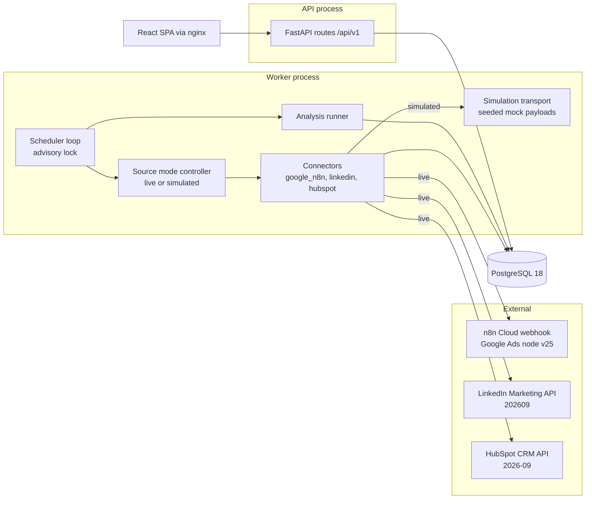
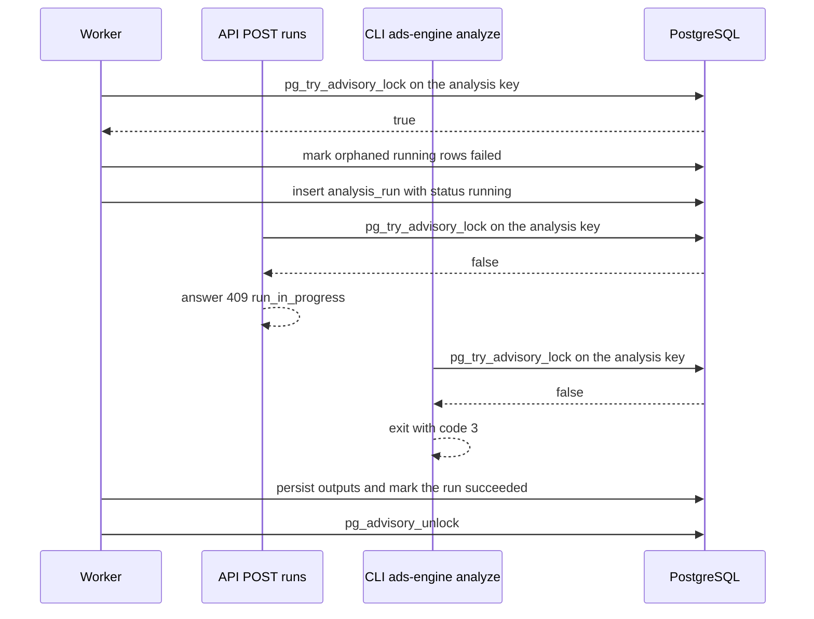
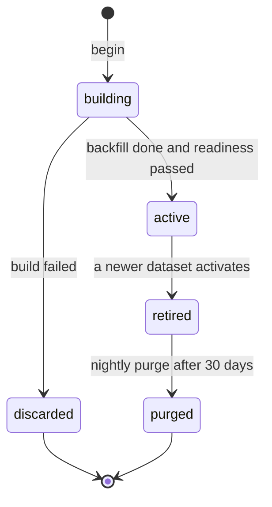

# Ads Action Engine architecture

The Ads Action Engine is an internal, single-tenant, recommend-only engine. It syncs LinkedIn
Ads, Google Ads (through the existing n8n Cloud webhook) and HubSpot CRM, and turns that data
into ranked actions in five sections: Keywords to adjust, Campaigns to pause or launch, Budget
changes, Copy/creative changes and White papers. Every action carries the numbers and the exact
date window that justify it. The product never writes to LinkedIn, Google Ads or HubSpot: the
user applies each change in the platform and records the decision in the tool, and the next
entity sync either confirms it or raises a discrepancy.

This page is for an engineer or operator who must understand how the product works before
changing or running it. It describes what the code does and names the module that owns each
behaviour. Configurable values are quoted with their key: `config/thresholds.yaml` keys as
`` `key` (default X) ``, environment variables as listed in `.env.example`, and code constants
by name.

Related documents: [recommendation rules](recommendation-rules.md) (every rule, threshold and
flag), [runbook](runbook.md) (setup, secrets, simulated mode, recovery), the integration notes
for [Google Ads via n8n](integrations/google-ads-n8n.md), [LinkedIn](integrations/linkedin.md)
and [HubSpot](integrations/hubspot.md), and the [project README](../README.md).

## Contents

- [Pattern](#pattern)
- [Components](#components)
- [Package map](#package-map)
- [Interaction rules](#interaction-rules)
- [Data flow](#data-flow)
- [Schedule and continuous analysis](#schedule-and-continuous-analysis)
- [Locks](#locks)
- [Datasets and provenance](#datasets-and-provenance)
- [Freshness and completeness](#freshness-and-completeness)
- [Source modes and fallback](#source-modes-and-fallback)
- [Google call budget](#google-call-budget)
- [Data model](#data-model)
- [Security](#security)
- [Web UI layer](#web-ui-layer)
- [Logging and health](#logging-and-health)
- [Related documents](#related-documents)

## Pattern

The product is a modular monolith:

- One Python package, `ads_engine` (`backend/src/ads_engine/`), runs as two processes: `api`
  and `worker`. Both are built from one image, `backend/Dockerfile`.
- A React single-page app (`web/`) is built to static files and served by nginx.
- PostgreSQL 18 is the only state store. There is no separate cache, queue or object store:
  schedules, request queues, locks, call budgets and run history all live in the database.

One tenant (one Google Ads customer, one or more LinkedIn ad accounts, one HubSpot portal) and
one team make microservices pure overhead. One codebase and one database avoid cross-service
deployment and consistency cost at this data volume (thousands to low millions of daily rows).
The API can run as several replicas, because sessions are signed cookies. The worker runs as a
single active instance, enforced by an advisory lock ([Locks](#locks)).

## Components

The local stack is `docker-compose.yml` (Compose project `ads-engine`).

| Service | Image | Command | Starts when | Notes |
|---------|-------|---------|-------------|-------|
| `db` | `postgres:18.6` | Image default | First | Healthcheck `pg_isready -h 127.0.0.1` over TCP every 5 s, 20 retries. Named volume `pgdata` at `/var/lib/postgresql`. Receives only `POSTGRES_DB`, `POSTGRES_USER` and `POSTGRES_PASSWORD`. No published port |
| `migrate` | `ads-engine-backend:local`, built from `backend/Dockerfile` (`python:3.14.8-slim`) | `ads-engine migrate && ads-engine ensure-admin` | `db` is healthy | One-shot, `restart: "no"`. Both commands are idempotent, so it runs again on every `up` |
| `api` | `ads-engine-backend:local` | `uvicorn ads_engine.api.app:create_app --factory --host 0.0.0.0 --port 8000 --proxy-headers --forwarded-allow-ips "*"` | `migrate` exited 0 | Serves `/api/v1`. Healthy when `GET /api/v1/healthz` answers 200, which needs a database round trip. Port 8000 is never published |
| `worker` | `ads-engine-backend:local` | `python -m ads_engine.worker.main` | `migrate` exited 0 | Owns all external I/O. `stop_grace_period: 30s` lets it cancel its work and release its advisory locks |
| `web` | Built from `web/Dockerfile` (`node:24.21.0-slim` build stage, `nginx:1.30.5` runtime) | nginx | `api` is healthy | The only published port, `8080:8080`. Serves the SPA and proxies `/api/` to `api:8000` (`web/nginx.conf`). Receives no environment |

Each service has its own CPU and memory ceiling (`deploy.resources.limits`), which bounds how much
of the host a backfill, an analysis run, PostgreSQL or nginx can use. The defaults are `db` 1 CPU
and 1 GiB, `migrate` 1 and 512 MiB, `api` 1 and 1 GiB, `worker` 1 and 2 GiB, and `web` 1 and
256 MiB. Compose variables override them from the shell or `.env`: `<SERVICE>_CPU_LIMIT` and
`<SERVICE>_MEMORY_LIMIT`, for example `WORKER_MEMORY_LIMIT`. Only Compose reads them, and
`.env.example` lists them with these defaults ([runbook](runbook.md#resource-limits)). They are
ceilings, not reservations, and never change the single worker instance.

Startup order:

```text
db (healthy) --> migrate (exit 0) --> api (healthy) --> web
                                  \-> worker
```

Shared backend settings (the `x-backend` anchor):

- `.env` reaches `migrate`, `api` and `worker` through `env_file`, and nothing else. A missing
  `.env` stops Compose before any container starts.
- `DATA_MODE` is set as `${DATA_MODE:-auto}`, so a value in the shell overrides `.env`
  (`DATA_MODE=simulated docker compose up -d`).
- `./config` is bind-mounted read-only at `/app/config`, the backend's working directory.
  `docker compose restart api worker` picks up edited YAML, and the worker re-runs the default
  analysis when the configuration hash changed ([Rerun triggers](#rerun-triggers)).
- The named volume `pgdata` survives `docker compose down`; `docker compose down -v` deletes it.

## Package map

Backend modules, relative to `backend/src/ads_engine/`:

| Module | Responsibility |
|--------|----------------|
| `settings.py` | Typed environment settings (`Settings`, `get_settings()`). Secrets are `SecretStr`; startup checks refuse an unsafe base URL. Also holds the API version pins as code constants: `GOOGLE_ADS_API_VERSION` (v25), `LINKEDIN_API_VERSION` (`202609`) and `HUBSPOT_API_VERSION` (`2026-09`) |
| `logging.py` | structlog JSON logs on stdout, with secret, token and email redaction |
| `cli.py` | The `ads-engine` CLI: `hash-password`, `migrate`, `ensure-admin`, `sync --source`, `analyze --start --end`, `seed-simulated`, `capture-fixtures --source` |
| `decisions.py` | Decision patches per decision shape, discrepancy resolutions, rejection of writes on retired subjects |
| `db/` | `base.py` (column conventions), `session.py` (engine, sessions, dedicated lock connections), `models/` (seven model files, [Data model](#data-model)), `repositories.py` (idempotent upserts, snapshot appends, active and effective dataset lookups, analysis requests) |
| `connectors/` | `errors.py` (classification into `AccessDenied`, `TransientError`, `QueryDefect`), `http.py` (shared httpx client, retry, timeouts, redaction), `google_n8n/` (`client`, `queries` Q-G1 to Q-G8 and Q-G2b, `parser`, `partition`), `linkedin/` (`auth`, `client`, `parser`), `hubspot/` (`client`, `parser`, `search`) |
| `simulation/` | `generator.py` (seeded world), `scenarios.py` (scenario catalogue), `payloads.py` (live wire shapes, request validation), `transport.py` (httpx `MockTransport`) |
| `sync/` | `mode.py` (source modes, probes, fallback, builds), `datasets.py` (dataset lifecycle), `jobs.py` (sync jobs), `snapshots.py` (snapshots, baseline, discrepancy detection), `lead_match.py`, `freshness.py`, `scheduler.py`, `budget_guard.py` |
| `analysis/` | `window.py`, `thresholds.py`, `context.py`, `metrics.py`, `stats.py`, `text.py`, the rule modules (`keywords`, `campaigns`, `budget`, `creative`, `white_papers`, `discrepancy`), `attribution.py`, `precedence.py`, `runner.py`, `lock.py`, `overlay.py` |
| `api/` | `app.py` (application factory), `deps.py` (session and CSRF dependencies), `security.py`, `schemas.py`, `routes/` (`auth`, `runs`, `recommendations`, `decisions`, `discrepancies`, `sources`, `config`, `health`) |
| `worker/main.py` | The worker process: settings, logging, startup and the scheduler |

Web modules, relative to `web/src/`:

| Module | Responsibility |
|--------|----------------|
| `main.tsx`, `router.tsx` | SPA entry and routes (`/login`, `/actions`, `/decisions`, `/sources`, `/settings`) |
| `api/` | `client.ts` (fetch wrapper: credentials, CSRF header, error mapping), `types.ts` (response types matching `api/schemas.py`), `queries.ts` (TanStack Query hooks) |
| `design-system/` | The Blitzy OS indirection layer ([Web UI layer](#web-ui-layer)) |
| `features/` | `auth`, `actions`, `status`, `decisions`, `sources`, `settings` screens |
| `lib/format.ts` | Currency, percentage, source-labelled date and instant formatting |

Import boundaries keep the layers apart. `api/` never imports `connectors`, `sync` or
`simulation`. `analysis/runner.py` never imports `sync`, `connectors`, `simulation` or `api`.
Rule modules are pure functions of an `AnalysisContext` and perform no I/O.

## Interaction rules

- **The worker owns all external I/O.** It runs the connectors, writes facts and snapshots,
  resolves source modes, detects discrepancies and precomputes default-window analysis runs.
- **The API never calls LinkedIn, n8n or HubSpot.** It reads stored results and overlays
  current state on them. It computes custom-window runs from stored data only. It writes
  decisions, discrepancy resolutions, feedback, sync requests (`sync_request`) and analysis
  requests (`analysis_request`).
- **The SPA talks only to `/api/v1` through nginx.** Every request is same-origin, so the API
  installs no CORS middleware.
- **Nothing writes to a platform.** Every connector issues reads only.



## Data flow

One sync cycle, from platform to screen:

1. **Fetch.** A connector fetches raw payloads. Live clients go through the shared httpx client
   (`connectors/http.py`); simulated clients are the same classes on an httpx `MockTransport`.
2. **Parse.** The parser produces typed rows: Google micros become amounts, int64 strings become
   integers, and conversions stay decimals.
3. **Upsert facts.** Idempotent upserts (`INSERT … ON CONFLICT DO UPDATE` on natural keys that
   include `dataset_id`, `db/repositories.py`) write the daily facts into the source's dataset.
   Restated values overwrite earlier ones, and a complete re-fetch drops rows the platform no
   longer returns, so re-running a sync is safe.
4. **Append snapshots.** Entity state is appended to `entity_snapshot`, one row per entity per
   entity sync. The table is append-only: rows are never updated.
5. **Record freshness.** Each job updates `dataset_freshness` for the datasets it wrote, in the
   same transaction as the data it describes (`sync/freshness.py`).
6. **Detect discrepancies.** Immediately after each entity sync, in the transaction that wrote
   the snapshots, every subject's newest snapshot is compared with its current decision
   (`sync/snapshots.py`).
7. **Analyse.** Each publication to an active dataset queues one `analysis_request`. The runner
   (`analysis/runner.py`) builds the window, aggregates the facts in SQL, evaluates the rule
   modules in a fixed order (C0, keywords, campaigns, budget, creative, white papers), applies
   precedence and ranking, and persists the run with its recommendations, findings, withheld
   patterns and suppression counts in one transaction. It never mutates them afterwards.
8. **Serve.** The API serves the latest default run, or a custom run by id, with the
   current-state overlay ([Current-state overlay](#current-state-overlay)).

A job reads a dataset's whole scope first and publishes it in one transaction: rows, deletions,
freshness, the `sync_run` close and the `analysis_request`. No transaction is held open across
a connector call, so a cancellation or failure before that commit leaves the stored data as it
was.

Inside one run (`analysis/runner.py`):

1. Take the `analysis` lock ([Locks](#locks)).
2. Insert the `running` `analysis_run` row and commit it.
3. Claim the pending `analysis_request` rows the run serves.
4. Load the `AnalysisContext` in one read-only `REPEATABLE READ` transaction, so every query
   sees one snapshot while syncs keep writing.
5. Evaluate the rules, precedence and row rendering on a single analysis thread, off the event
   loop, so the API keeps serving stored pages while a custom run computes.
6. Persist every output together with the run's `succeeded` state, the dataset ids and the
   modes it read, in one transaction. Any failure marks the run `failed` instead, so a run is
   never partial.

### Fetch policy

- **Daily facts** are fetched incrementally and restated, never stored as window aggregates.
  Any window is derived from the stored daily rows.
- **LinkedIn demographic segments** are the one exception. LinkedIn approximates and
  privacy-thresholds those values, so daily rows cannot be summed into a window. They are
  fetched per preset window in `window.presets` (default `[14, 28, 56, 90]`), each ending on the
  default window end, into `fact_segment_window`, keyed by the exact window.
- **C3a** uses segments only when the run window exactly matches a fetched segment window, with
  the same start and end dates. Otherwise, while at least one LinkedIn campaign is active, C3a
  is withheld with the finding `segment_window_unavailable` and never reuses another window's
  segments ([recommendation rules](recommendation-rules.md)).
- **Entity state** is fetched in full every entity sync, because the data is small and full
  state is what the discrepancy check compares.
- **Snapshots** of the active dataset are never purged, so status, budget and quality-score
  trends can be computed over any window. Only retired datasets are purged
  ([Dataset lifecycle](#dataset-lifecycle)).

### Native day boundaries

- Each source's daily rows keep their native day: Google `segments.date` in the customer
  account's time zone (`customer.time_zone`, read by Q-G1), LinkedIn on UTC. Rows are never
  relabelled or rebucketed.
- A window is one calendar-date range applied to each source's own dates. Evidence lists each
  source's range and boundary in `source_days`, and says so when the boundaries differ.
- No computation combines two sources' daily rows into one daily series. Cross-source joins work
  on instants: LinkedIn leads count when `submittedAt` falls in [start 00:00 UTC, end + 1 day
  00:00 UTC), and HubSpot events are compared as instants.
- `DISPLAY_TIMEZONE` (default `UTC`) only formats instants for display. It never moves a day
  boundary.
- The default window is `window.default_days` (default 28) complete days. It ends on the
  earlier of yesterday in the Google account's time zone and yesterday in UTC
  (`analysis/window.py`, `default_end`), so today, a partial day, is excluded.
- A custom window spans 1 day to `window.max_days` (default 180, LinkedIn's daily retention) and
  ends no later than the default window end. A window shorter than `window.trusted_min_days`
  (default 14) carries the short-window banner and flag.

### Performance targets

- The five sections render from precomputed runs in under 2 s. `GET /api/v1/recommendations`
  reads stored rows, and the overlay issues at most eight statements per page, whatever the
  number of items.
- A custom-window run of up to `window.max_days` (default 180) on a typical account computes in
  under 30 s, because aggregation runs as SQL group-bys and statistics run on small aggregated
  vectors, never on raw rows.
- `POST /api/v1/runs` computes synchronously. The API cancels any request after its own 45 s
  deadline (503 `request_timeout`), and nginx waits up to 120 s (`proxy_read_timeout`), so a
  slow request still ends in the API's error envelope.

## Schedule and continuous analysis

"Continuously" means scheduled syncs plus an analysis refresh after every data or decision
change. The schedule is `SCHEDULE` in `sync/scheduler.py`; the jobs are in `sync/jobs.py`.

- **Wakes.** The active worker wakes every 30 s (`WAKE_INTERVAL`) on absolute deadlines. Each
  wake picks up due jobs, pending `sync_request` rows ("Sync now") and pending
  `analysis_request` rows.
- **Slots.** Scheduled times are wall-clock times in `DISPLAY_TIMEZONE` (default `UTC`).
- **Due-ness.** A job is due when its latest slot is later than the `started_at` of the most
  recent `sync_run` of that (source, job), whatever its status. The history is in the database,
  so due-ness survives restarts, and slots missed during downtime run once, not once per missed
  slot.

### Jobs

| Job (`sync_run.job`) | Sources | Cadence | Fetch scope |
|----------------------|---------|---------|-------------|
| Entity sync (`entities`) | Google, LinkedIn | Every 3 h (00:00, 03:00, …) | Full current state in all statuses. LinkedIn: ad accounts, campaign groups, campaigns, creatives with their posts, lead forms. Google: Q-G1, Q-G2 and Q-G2b, Q-G4, Q-G7, Q-G8. One `entity_snapshot` row per entity per sync, including the quality score of keywords with no traffic. Baseline decisions and the discrepancy check run in the same transaction |
| Metrics, incremental (`metrics`) | Google, LinkedIn | Every 6 h (00:00, 06:00, 12:00, 18:00) | Daily facts for the trailing 3 days, upserted over earlier values |
| Metrics, restatement (`restatement`) | Google, LinkedIn | Daily at 03:00 | Google: trailing 30 days, to absorb conversion lag. LinkedIn: trailing 14 days |
| LinkedIn demographic segments (`segments`) | LinkedIn | Daily at 04:00, and whenever `jobs.segments_due` finds no segment data, coverage ending before the current default window end, or a changed `window.presets` (checked on every wake). Also inside every new LinkedIn dataset's backfill | `q=statistics`, `timeGranularity=ALL`, one request per account, demographic pivot and preset in `window.presets` (default `[14, 28, 56, 90]`), each ending on the default window end |
| LinkedIn lead responses (`leads`) | LinkedIn | Every 3 h | Responses submitted since the last successful lead sync minus 1 h of overlap, de-duplicated on response id. Test leads are never stored, emails only as SHA-256. Each new lead gets a `lead_match` row. A simulated LinkedIn dataset's companion CRM dataset is synced inside this run |
| CRM (`crm`) | HubSpot | Every 3 h | Due `lead_match` rows (matching), contact refresh by id, contact-to-meeting, contact-to-deal and deal-to-contact associations with full paging and target reads, the partitioned deal search over the window, and Google-touch contact discovery when both Google CRM properties are configured |
| Recovery probe (`probe`) | Any source in automatic fallback | At most every 30 min (`PROBE_INTERVAL`, `sync/mode.py`) | The source's full capability set ([Recovery](#recovery)) |
| Initial backfill | Every source | First start, and every new dataset | `BACKFILL_DAYS` (default 180), capped at 180 days for every source, LinkedIn's 6-month daily retention. The backfill records `entities`, `metrics`, `restatement`, `segments`, `leads` and `crm` runs, so a fresh start does not repeat them on its first wake |
| Purge (`purge`) | All | Daily at 05:00 | Datasets retired more than 30 days ago (`RETENTION`, `sync/datasets.py`) |
| Call-budget refresh | Google | Every wake | Recomputes `source_connection.calls_24h` ([Google call budget](#google-call-budget)) |
| Default-window analysis | — | From the `analysis_request` queue, once the oldest pending request is 60 s old (`COALESCE_WINDOW`) | The configured default window; every pending request is served by one run |
| Custom-window analysis | — | On demand: `POST /api/v1/runs` or `ads-engine analyze --start --end` | Stored data only |
| "Sync now" | One source | At the next wake after `POST /api/v1/sources/{source}/sync` | That source's sync jobs. At most one pending `sync_request` per source; a second request gets 409 `sync_pending` |

HubSpot has no entity job: its contacts, meetings, deals and associations are read by the `crm`
job. The purge's 05:00 slot follows the restatement and segment slots, but lanes do not wait for
each other. That is safe, because no job writes a retired dataset.

### Lanes

Each wake dispatches every idle lane as an asyncio task, at most one task per lane, so a long
Google request or backfill delays only its own lane.

| Lane | One pass |
|------|----------|
| `google` | Google's dataset, recovery probe, `sync_request` and due jobs |
| `linkedin_hubspot` | The same for HubSpot and LinkedIn, then LinkedIn's segments. One lane serialises them, so every HubSpot dataset has a single CRM writer, HubSpot's primary is ensured before a LinkedIn build stages leads against it, and LinkedIn's leads run before HubSpot's `crm` job matches them |
| `purge` | The 05:00 purge |
| `budget` | The Google call-budget refresh |
| `analysis` | The wait until the oldest pending request is 60 s old, then one default-window run |

A busy lane still gets one short trigger check per wake. When work is pending, the lane is
dispatched again the moment its pass ends instead of at the next wake.

### Worker startup

Before the first wake, the active worker runs its startup once (`worker/main.py`, `startup`):

1. Load `config/*.yaml` again and replace the content-asset tables with the white paper registry
   (`config/content_assets.yaml`).
2. Compare the configuration hash with the latest succeeded default run's `config_hash`, and
   queue a `config_changed` analysis request when they differ.
3. Bootstrap every source in the order Google, HubSpot, LinkedIn (`BOOTSTRAP_ORDER`): resolve it
   live or simulated, then build, backfill and activate a dataset where none of that mode is
   active. With no credentials, every source is simulated with the reason
   "credentials not configured".
4. Compute the default-window analysis, so the first default run exists before the first
   scheduled cycle. Behind another holder of the `analysis` lock, a `startup` request is queued
   instead.

A configuration file that fails to load stops the worker with exit code 1 before it tries the
scheduler lock.

### Rerun triggers

Each of these queues a default-window `analysis_request`; the reason is stored on the row:

- a completed entity, metrics, segment, lead or CRM sync of an active dataset (a building
  dataset queues nothing; its activation does);
- a dataset activation (`dataset_activated:{source}`) or a source-mode change
  (`mode_changed:{source}`);
- a decision write (`decision`);
- a discrepancy created or resolved (`discrepancy_created`, `discrepancy_resolved`);
- a feedback write: dismiss, snooze or done (`feedback`);
- a changed configuration detected at worker startup (`config_changed`): the `config_hash` of
  the three `config/*.yaml` files differs from the latest succeeded default run's;
- a lost lock: a default run whose `analysis` lock connection was lost before it persisted
  (`analysis_lock_lost`), or a worker that re-acquired the scheduler lock after losing it
  (`scheduler_lock_lost`).

The worker coalesces requests that arrive within 60 s (`COALESCE_WINDOW`) into one run.

### Current-state overlay

A stored run is immutable evidence, but what the screen shows must not go stale after a change.
`GET /api/v1/recommendations` therefore adds read-time fields, `current` on each item and
`overlay` on the page, computed by `analysis/overlay.py` from live tables. It never rewrites the
frozen evidence; it only adds holds, flags and hidden state:

- **Open discrepancies** are read live, so a discrepancy detected after the run holds every
  dependent item at once, and the banner count is always current.
- **Source modes, active datasets and dataset freshness** are read live, so simulation labels
  and stale or incomplete flags stay current.
- **Feedback** (dismiss, snooze, done) is read live, as `current.hidden_by`.

### Historical-only items

- Each item's `evidence.provenance` freezes the dataset id, mode and role of every dataset it
  read, as they were when the run computed it. For LinkedIn-attributed CRM evidence that is the
  effective CRM dataset ([Companion CRM dataset](#companion-crm-dataset)).
- If any of those datasets is no longer active, or no longer the effective CRM dataset, the
  item is `historical`: `current.historical = true` and `current.held_now = true` with the reason
  "Computed from data that has since been replaced".
- An item whose provenance is missing or malformed cannot be checked, so it fails closed and is
  historical too.
- Every action on a historical item is disabled in the UI: Record decision, Mark done, Dismiss,
  Snooze and the C0 resolver. A write against it returns 409 `subject_retired`.
- `current.data_status_now` reports the current source status separately, so a card computed
  from simulated data still says so after the source goes live.

This applies during an activation until the queued rerun completes, and indefinitely to an older
custom run.

### Run kinds and selection

- `kind=default` runs are the worker's runs of the configured default window.
- `kind=custom` runs come from `POST /api/v1/runs` or `ads-engine analyze`, even when their
  window equals the default.
- `GET /api/v1/runs/latest` and `GET /api/v1/recommendations` without `run_id` return only the
  latest succeeded default run, so a manual 90-day run never stands in for the default. The UI
  addresses a custom run by id, as `/actions?run=<id>`.

## Locks

All locks are PostgreSQL session-level advisory locks, so a lock dies with the database session
that took it: a crashed process can never leave one held. Each key is derived once, by its
owner, from a name: the first 8 bytes of the SHA-256 digest of the name, read as a signed
64-bit integer.

| Lock | Key (owner) | Held by | Purpose |
|------|-------------|---------|---------|
| Scheduler | `SCHEDULER_LOCK_KEY` from `ads_engine:scheduler` (`sync/scheduler.py`) | The active worker, on a dedicated `AUTOCOMMIT` connection | One active worker |
| Sync writer | `SYNC_WRITER_LOCK_KEY` from `ads_engine:sync_writer` (`sync/scheduler.py`) | `ads-engine sync` and `ads-engine seed-simulated`, shared | Keeps the worker's recovery of orphaned `sync_run` rows from closing a live command's rows |
| Analysis | `ANALYSIS_LOCK_KEY` from `ads_engine:analysis` (`analysis/lock.py`) | Whoever computes a run: API, worker or CLI | One analysis run at a time |

### Scheduler lock

- `Scheduler.run_forever` takes `pg_try_advisory_lock(SCHEDULER_LOCK_KEY)`. A second worker finds
  it taken, logs `scheduler.standby` once and retries every 30 s (`STANDBY_RETRY`). It takes over
  the moment the active worker's database session ends: a graceful exit, a crash or a lost
  connection.
- After every acquisition the worker waits 20 s (`LOCK_TAKEOVER_GRACE`) and proves the lock again
  before any work. While work runs, it proves the lock session alive every 5 s
  (`LOCK_CHECK_INTERVAL`), each check bounded by 5 s (`LOCK_CHECK_TIMEOUT`), and again before
  every lane dispatch.
- On a lost lock it cancels every lane and waits at most 5 s (`LOCK_LOST_STOP_TIMEOUT`) for them to
  end. Work still running after that could still write, so the process aborts with exit code 1
  and the container restarts it. Only when the database itself stops answering does it keep
  waiting, because then no other worker can take the lock either. These bounds are checked at
  import to stay inside the 20 s grace, so two workers never run work at the same time.
- Startup work ([Worker startup](#worker-startup)) runs only on the active worker. A standby still
  validates `config/*.yaml` at process start and exits with code 1 on an invalid file.
- After each acquisition, `sync_run` rows left `running` by a dead process are recorded `failed`
  ("interrupted"), and the "Sync now" request they served is made pending again.
- The scheduler never takes the `analysis` lock.

### Analysis lock

- `analysis/lock.py` takes a session-level `pg_try_advisory_lock(ANALYSIS_LOCK_KEY)` on a dedicated
  `AUTOCOMMIT` connection, held for the whole run. `run_analysis` acquires it itself, so the API,
  the worker and the CLI share one convention and no caller takes the lock directly.
- The partial unique index `uq_analysis_run_single_running` on `analysis_run`
  (`WHERE status = 'running'`) is a second, database-enforced guard: at most one row is ever
  `running`.
- **When the lock is unavailable**, `RunInProgress` is raised at once, without waiting:
  - the API answers 409 `run_in_progress`;
  - the worker leaves its `analysis_request` rows pending for a later wake;
  - `ads-engine analyze` exits with code 3 (`EXIT_LOCK_HELD`).
- **Crash recovery**: a `running` row left by a crashed process has no lock holder, because its
  session died. The next process to take the lock marks every `running` row `failed` before its
  own run starts.
- The runner's final status update requires the row to still be `running`. If the lock
  connection was lost mid-run and another process marked the row `failed`, nothing is written.



## Datasets and provenance

Every source-derived row carries a `dataset_id` that references `source_dataset`: facts,
entities, snapshots, leads, CRM contacts, meetings, deals, associations, association fetches,
decisions, discrepancies and freshness rows. `lead_match` is the one exception: it links two
datasets, so it carries `crm_dataset_id` and reaches its lead's dataset through `lead_id`. A
source's active dataset is entirely live or entirely simulated, so real and fictional ids never
join within one source. `sync/datasets.py` (`DatasetManager`) owns every state change.

`source_dataset` columns (`db/models/ops.py`):

| Column | Meaning |
|--------|---------|
| `source` | `google`, `linkedin` or `hubspot` |
| `mode` | `live` or `simulated` |
| `state` | `building`, `active` or `retired` |
| `role` | `primary`, or `companion` for the simulated CRM dataset of a simulated LinkedIn dataset |
| `parent_dataset_id` | The LinkedIn parent of a companion; null for a primary. The `role_shape` check requires a companion to be HubSpot, simulated and parented |
| `reason` | Why the dataset exists, for example "credentials not configured" or the access-denied code that caused a switch |
| `created_at`, `activated_at`, `retired_at` | Lifecycle timestamps |
| `crm_bindings` | HubSpot datasets only: the MQL and QL stage properties and stage ids resolved against that portal, their availability, and the verification of the Google CRM properties. Attribution and `GET /api/v1/config` read it without calling HubSpot |

- The partial unique index `uq_source_dataset_active_primary` allows at most one `active`
  primary per source.
- Reads, aggregations and rules filter to each source's active primary dataset. Rows from a
  retired dataset never enter a computation.
- LinkedIn-attributed CRM evidence reads the effective CRM dataset instead
  ([Companion CRM dataset](#companion-crm-dataset)).
- Decisions and discrepancies are dataset-scoped, so a simulated decision never becomes the
  expected state of a live campaign. The first entity sync of each new dataset writes a baseline
  decision (`origin=baseline`) for every campaign and every shared budget, so the product raises
  no false discrepancy on day one.

### Dataset lifecycle



- **Build.** `DatasetManager.begin` inserts a `building` dataset (with its companion, for a
  simulated LinkedIn dataset). The worker backfills it; its first entity sync writes the baseline
  decisions.
- **Activate.** Once `DatasetManager.readiness` passes, one transaction, serialised on the
  source's `source_connection` row, activates the dataset (and its companion) and retires the
  source's previous active primary (and its companions) together with their matching state.
  Until then the previous dataset stays active and labelled. The activation queues a
  `dataset_activated:{source}` analysis request.
- **Discard.** A failed build is deleted and the previous dataset stays active. A `building`
  primary older than 6 h (`ABANDONED_BUILD_AFTER`, `sync/mode.py`) is treated as abandoned by a
  crashed build and discarded. A live build may activate only while the source's
  `source_connection.access_generation` is unchanged since its probe, so an access denial recorded
  by any process voids every earlier live build.
- **Retire and purge.** Retired datasets are read-only and kept 30 days (`RETENTION`). The nightly
  purge then runs one `DELETE FROM source_dataset WHERE id = :retired` per dataset, each in its
  own transaction. The `ON DELETE CASCADE` foreign keys remove every dependent row in a
  referentially safe order, so the purge encodes no table order:
  - every `dataset_id` reference, and every foreign key between rows of the same dataset, cascades;
  - across datasets, only `lead_match` links a LinkedIn lead to a CRM contact, and its keys to
    `lead`, `crm_contact` and `crm_dataset_id` cascade too, so purging a retired HubSpot dataset
    deletes only its own matches;
  - `parent_dataset_id` cascades, so a companion is purged with its parent.
- **Run history survives.** `recommendation`, `run_finding` and `run_withheld` reference
  entities through nullable keys with `ON DELETE SET NULL`, and keep their evidence denormalised
  in `jsonb` with the provenance dataset ids. `analysis_run.dataset_ids` is `jsonb` with no
  foreign key. A purged run therefore still renders, as historical-only.

### Companion CRM dataset

- Building a simulated LinkedIn dataset also builds a companion:
  `source_dataset(source=hubspot, mode=simulated, role=companion, parent_dataset_id=<the LinkedIn dataset>)`.
  It holds the generated contacts, meetings, deals, associations, association fetches,
  `lead_match` rows and its own `hubspot.contacts`, `hubspot.associations` and
  `hubspot.deal_search` freshness rows. It activates and retires in the same transaction as its
  parent.
- The **effective CRM dataset** (`db/repositories.py`, `effective_crm_dataset_id`) is the
  companion while LinkedIn's dataset is simulated, and HubSpot's active primary otherwise. C1b,
  the C2 pipeline veto and the white paper rules read matching, stage dates, meetings, deals,
  freshness and coverage from it.
- The Google-to-CRM link always reads HubSpot's active primary dataset, live or simulated.
- Simulated leads carry `@sim.invalid` emails, which the HubSpot client never sends to a live
  portal. Simulated leads are matched only against their own companion.
- When HubSpot is simulated while LinkedIn is live, the simulated HubSpot transport answers real
  lead emails with seeded contacts for a deterministic share of them. Simulated ids come from
  reserved ranges, so they never collide with live ids, and they retire with their dataset.
- Items built on joins between a live and a simulated dataset carry `data_status=mixed`.

### Staged matching on a CRM dataset change

- A new CRM dataset is matched while it is still `building`, with `pending` `lead_match` rows
  (lead, building dataset) staged by `sync/lead_match.py`:
  - a HubSpot primary build stages every lead of the active LinkedIn dataset in the backfill
    range, when that LinkedIn dataset is live (simulated leads read their companion);
  - a companion build stages its parent's leads.
- The build then runs matching, contact refresh, associations with target reads, the deal search
  and, for a primary, Google-contact discovery in the building dataset. The previous dataset's
  matches stay active and in use throughout.
- **Readiness** (`DatasetManager.readiness`) requires every staged row to have been attempted at
  least once (any status but `pending`), and every required freshness row to be recorded with a
  successful latest attempt and to be `complete`, or `incomplete` with a reason that is not unread
  work, never `unknown`.
- A new live LinkedIn dataset likewise stages its backfilled leads against HubSpot's active
  primary, and every row is attempted before it activates. LinkedIn-attributed CRM evidence is
  therefore complete from the first run on the new dataset.
- Leads ingested after activation get rows in the active dataset as usual. Matching details,
  the retry schedule and the email handling are in [HubSpot](integrations/hubspot.md).

## Freshness and completeness

`dataset_freshness` holds one row per (`dataset_id`, `dataset`), for the eleven dataset names in
`DATASETS` (`db/models/ops.py`):

| Source | Dataset names |
|--------|---------------|
| Google | `google.entities`, `google.metrics_daily`, `google.search_terms` |
| LinkedIn | `linkedin.entities`, `linkedin.analytics_daily`, `linkedin.segments`, `linkedin.leads` |
| HubSpot | `hubspot.contacts`, `hubspot.associations`, `hubspot.deal_search`, `hubspot.google_contacts` |

Each row records `last_attempt_at`, `last_success_at`, `covered_from`, `covered_through` (native
dates), `completeness` (`complete`, `incomplete` or `unknown`) and a `reason`. Google rows also
keep a `checkpoint`: the unread work of an interrupted or deferred fetch, which the next run reads
first. `hubspot.google_contacts` exists only when both Google CRM properties are configured and
verified.

`sync/freshness.py` (`record_freshness`) folds each job's outcome into its row:

- A failure moves only `last_attempt_at` and `reason`; the last good data, its coverage and its
  completeness stand.
- A success cut short by a transient error or a call-budget deferral records what it read, as
  `incomplete` with its reason, but does not move `last_success_at`.
- Reason prefixes are stable: "call budget exhausted" and "interrupted" are repairable by a
  re-fetch; "result limit reached at finest partition" (Google Q-G6) and "search result ceiling
  reached" (HubSpot CRM Search) are permanent platform limits.

Each rule declares the datasets it reads (`required_datasets`), and the runner and the overlay
derive each item's flags from those datasets only:

- An item is `stale` when a required dataset last succeeded more than `sources.stale_after_hours`
  (default 24) ago, or its coverage stops short of the window end.
- An item is `incomplete` when a required dataset is not `complete` over the window.
- A required dataset with no freshness row has never succeeded, so it is both stale and
  incomplete.
- A successful sync of one dataset never hides a failed refresh of another, because every write
  touches exactly one row.

## Source modes and fallback

Connectors raise only `AccessDenied`, `TransientError` or `QueryDefect`
(`connectors/errors.py`), and `sync/mode.py` (`SourceModeController`) alone decides what each one
means. Mode is decided per source by `DATA_MODE`:

- `auto` (default) applies the classification table below per source. A source whose access is
  unavailable or denied is always simulated, never left without data.
- `simulated` forces every source to simulated data with the reason "DATA_MODE=simulated". It
  never probes and never promotes a source to live, even when the probes would pass.

No mode leaves an access-denied source without data.

### Classification

| Condition | Classification | Behaviour |
|-----------|----------------|-----------|
| Required environment variables unset. Google needs `N8N_GOOGLE_ADS_WEBHOOK_URL`, `N8N_WEBHOOK_SECRET` and `GOOGLE_ADS_CUSTOMER_ID`. LinkedIn needs `LINKEDIN_AD_ACCOUNT_IDS` plus either the refresh-token trio (`LINKEDIN_CLIENT_ID`, `LINKEDIN_CLIENT_SECRET`, `LINKEDIN_REFRESH_TOKEN`) or `LINKEDIN_ACCESS_TOKEN`. HubSpot needs `HUBSPOT_ACCESS_TOKEN` | Access unavailable | The source is simulated, with the reason "credentials not configured" |
| HTTP 401 or 403; for LinkedIn, 401 after one token refresh; a Google body carrying `PERMISSION_DENIED`, `UNAUTHENTICATED`, `AuthorizationError` or `AuthenticationError`, even inside an n8n HTTP 200 | Access denied | The whole source switches to simulated data. The platform's error code and the failing endpoint are the reason |
| HTTP 429, 5xx, timeout, `RESOURCE_EXHAUSTED`, call budget exhausted | Transient | Retried by `connectors/http.py` (`DEFAULT_RETRY`): up to 3 attempts in total, with exponential backoff from a 2 s base (2 s, then 4 s, each plus up to 1 s of jitter, at most 30 s). A `Retry-After` (or Google `retryDelay`) of up to 120 s is honoured in full in place of the backoff; a longer one ends the call at once, so the work is deferred rather than sent early. When the call still fails, the connection's status becomes `stale` at once (a source in automatic fallback keeps `denied`), and a failed attempt is recorded on the freshness row of each affected dataset, whose last good data, `last_success_at`, coverage and completeness stand; an entity read cut short instead stores what it read as `incomplete`, which leaves `last_success_at` unmoved too. A failed attempt alone flags no item: items reading the dataset are flagged stale only once its last success is older than `sources.stale_after_hours` (default 24) or its coverage stops short of the window end ([Freshness and completeness](#freshness-and-completeness)). Never mock. A call-budget refusal is never retried; it is a deferral ([Google call budget](#google-call-budget)) |
| HTTP 400, GAQL `QueryError`, validation error | Defect | The job fails and is logged with the query id. No mock, no retry |

Per-call timeouts are 120 s for a Google webhook call, and 60 s for LinkedIn and HubSpot calls
(`SOURCE_TIMEOUTS`, `connectors/http.py`).

`source_connection` (one row per source) holds the resolved `mode`, a health `status` (`ok`,
`stale`, `denied` or `error`) and the `reason`. **Automatic fallback** is the state
`mode='simulated', status='denied'` under `DATA_MODE=auto` with credentials present. Only a
source in automatic fallback gets recovery probes.

### Granularity

Fallback is per source, and a source's active dataset is entirely live or entirely simulated.
A 403 on any LinkedIn endpoint therefore switches all of LinkedIn to simulated data. That
includes a 403 on Lead Sync alone, when `r_marketing_leadgen_automation` is not granted, because
simulated leads cannot reference real creatives. Switching mode always means building,
backfilling and atomically activating a new dataset ([Dataset lifecycle](#dataset-lifecycle)).

### Recovery

While a source is in automatic fallback, the worker probes its full capability set at most every
30 min (`PROBE_INTERVAL`). Every probe is recorded as a `probe` `sync_run`, whose start spaces the
next one.

- **Google**: Q-G1 through the webhook.
- **LinkedIn**, per configured ad account: `adAccounts/{id}`, a one-day `adAnalytics` request
  (yesterday UTC), `leadForms` with `count=1` and `leadFormResponses` with `count=1`.
- **HubSpot**: a one-email contacts batch read, a one-result deals search and a one-input
  associations batch read.

Outcomes:

- **Every check passes**: the worker builds and backfills a live dataset and activates it only
  once the backfill completes. For HubSpot, the build must also pass the staged-matching readiness
  test.
- **A build fails**: the building dataset is discarded and the simulated one stays active.
- **Partial success** (for example LinkedIn ads readable while Lead Sync still returns 403) is a
  failed probe and changes nothing, so a source never flips back and forth.

A probe that meets only transient errors marks the source `stale` and keeps its active dataset; a
probe that meets a defect marks it `error`. Neither causes a fallback. Credentials added before a
restart go live through the same probe-then-build path at startup, with no code change.

### Contract fidelity

- `simulation/payloads.py` renders the seeded world (`MOCK_SEED`, default 42) in the exact live
  wire shapes: camelCase Google rows without a page token; LinkedIn URNs, `count`/`start` paging
  and versioned form URNs with form decoration; HubSpot `paging.next.after`, per-input association
  paging and CRM Search `total`.
- Requests are validated against the same contracts, so a request missing a required selector
  fails in simulated mode too.
- The contracts are files in `backend/tests/contracts/{google,linkedin,hubspot}/`, one per surface,
  each recording the official reference URL and its version or last-modified date, the request
  shape and the documented sample response. The simulator and the contract tests both read them.
- `simulation/transport.py` serves the payloads through an httpx `MockTransport`, so the live
  clients and parsers run unchanged in simulated mode. Simulated data is seeded, so tests and
  demos reproduce exactly.
- Once credentials work, `ads-engine capture-fixtures --source <source>` attempts every surface.
  For each surface with data to read, it records one redacted live request and response into
  `backend/tests/contracts/<source>/captured/`. A surface with no data is skipped with a
  `cli_warning` line, and the exit can still be 0, so check the warnings before relying on the
  captures ([Capturing live contract fixtures](runbook.md#capturing-live-contract-fixtures)).

### Labelling

- `source_connection` records each source's mode, status, reason and active dataset.
  `GET /api/v1/sources` and the `/sources` screen show them with per-dataset freshness.
- Every `recommendation` stores `data_status`: `live`, `simulated`, `stale` or `mixed`.
- The UI shows a per-source "Simulated" chip, a global banner naming the simulated sources and
  their reasons, and a "Simulated data" flag on each affected item.

## Google call budget

The Google Ads quota belongs to the developer token inside n8n's Google Ads credential. Every
other n8n workflow using that credential draws on it, and the product cannot see it. The product
therefore caps its own webhook calls (`sync/budget_guard.py`, `GoogleCallBudget`):

- `GOOGLE_DAILY_CALL_BUDGET` (default 1000) caps webhook calls per sliding 24 h, below the 2,880
  operations of Explorer, the smallest documented access level.
- The cap counts every webhook POST attempt the product makes: first pages, next-page calls,
  partition calls and retries. The client books each attempt against the budget before sending
  it, and a refusal sends nothing and books nothing.
- State lives on the `google` row of `source_connection`, as call bookings per UTC minute
  (`calls_by_minute`) updated under `SELECT … FOR UPDATE`, so the worker, `ads-engine sync` and
  `ads-engine capture-fixtures` share one cap. `calls_24h`, the total of the bookings still
  counting, is shown on `/sources` against the cap and refreshed on every wake. It is a
  conservative upper bound on the POSTs of the trailing 24 h, not an exact count: a minute
  bucket counts until 24 h after the minute ends; a call is booked in the minute holding its
  admission instant plus the 140 s dispatch bound, the minute by which its POST has started, so
  it counts from admission for up to 24 h plus the bound plus one minute; and a booking that
  commits too late to cover its POST stays counted while the call is reserved again, so that
  call can count twice. Every POST therefore counts for at least 24 h after it starts, and the
  overcount only errs towards refusing a call: no sliding 24 h of POSTs exceeds the cap.
- A refused call is a deferral, never a retry. The remaining pages and partitions are deferred to
  a later 24 h window, and the unread scopes are kept as the dataset's freshness `checkpoint`,
  which the next run reads first. The affected datasets stay `incomplete` (reason "call budget
  exhausted; N partitions deferred") and keep their last good data. Their `last_success_at` does
  not move, so they turn stale once the last complete refresh is older than
  `sources.stale_after_hours` (default 24).
- An interrupted entity enumeration infers no removal or disappearance (safe absence).
- Simulated mode never meters: a simulated n8n call is not a Google call.

The webhook contract, partitioning and safe absence are in
[Google Ads via n8n](integrations/google-ads-n8n.md).

## Data model

The schema is created by the single Alembic migration
`backend/migrations/versions/0001_initial_schema.py`, which mirrors the SQLAlchemy models in
`backend/src/ads_engine/db/models/` (`alembic check` reports no drift). `ads-engine migrate` runs
it; it creates 41 tables plus `alembic_version`.

| Model file | Tables |
|------------|--------|
| `ops.py` | `source_dataset`, `dataset_freshness`, `app_user`, `source_connection`, `sync_run`, `sync_request` |
| `accounts.py` | `ad_account`, `campaign_group`, `campaign`, `budget`, `conversion_action`, `ad_group`, `keyword`, `creative`, `lead_form`, `lead_form_version`, `content_asset`, `content_asset_form`, `content_asset_creative` |
| `facts.py` | `fact_campaign_daily`, `fact_creative_daily`, `fact_keyword_daily`, `fact_search_term_daily`, `fact_segment_window` |
| `snapshots.py` | `entity_snapshot` |
| `crm.py` | `lead`, `lead_match`, `crm_contact`, `crm_meeting`, `crm_deal`, `crm_association`, `crm_association_fetch` |
| `decisions.py` | `decision`, `discrepancy` |
| `analysis.py` | `analysis_run`, `analysis_request`, `recommendation`, `run_finding`, `run_withheld`, `run_suppression`, `recommendation_feedback` |

Conventions (`db/base.py`):

- **Money** is `numeric(18,6)` in the account's currency, never converted or summed across
  currencies. Google `cost_micros` is divided by 1,000,000 at parse time, and Google budgets also
  keep `amount_micros` (`bigint`), so the discrepancy check compares at native precision.
- **Conversions** are `numeric(18,6)`, because Google reports them as doubles.
- **Instants** are `timestamptz`. **Daily fact dates** are each source's native date.
- **Enumerations** are `text` columns with a `CHECK` constraint, never PostgreSQL `ENUM` types.
- **Natural keys** include `dataset_id`, and daily facts are unique per (`dataset_id`, entity key,
  date).
- **Foreign-key actions**: every `dataset_id`, `crm_dataset_id` and `parent_dataset_id` reference
  and every key between rows of one dataset is `ON DELETE CASCADE`; run-table keys to entities are
  `ON DELETE SET NULL` ([Dataset lifecycle](#dataset-lifecycle)).
- **Personal data**: `app_user.email` is the only email column. Lead and contact emails are stored
  solely as SHA-256 hashes (`email_sha256`).

State beyond fetched data:

- **Snapshots** (`entity_snapshot`) are append-only observations of status, budget, budget
  membership and quality score, written by every entity sync. Budget history treats them as
  observations, never as effective times.
- **Decisions** (`decision`) are append-only. Each row holds one complete materialised expected
  state for its subject's shape: `own_budget` (a campaign with its own budget), `shared_member` (a
  Google campaign drawing from an explicitly shared budget: status and budget assignment, no
  amount) or `budget` (a Google shared budget: one amount, no status). The check constraint
  `ck_decision_shape_columns` enforces which columns each shape may fill. The latest row per
  subject is the "last decided" state. Baselines are written on each new dataset's first entity
  sync; later rows come only from `POST /api/v1/decisions` and discrepancy resolutions
  (`decisions.py`).
- **Discrepancies** (`discrepancy`) are computed after each entity sync; at most one unresolved
  row exists per (subject, kind).
- **Analysis outputs** (`recommendation`, `run_finding`, `run_withheld`, `run_suppression`) are
  written once by the runner and never mutated. `recommendation_feedback` is applied by the runner
  before ranking and live by the overlay.

Rule logic, decision shapes and resolutions are specified in
[recommendation rules](recommendation-rules.md).

## Security

Verified against `api/app.py`, `api/security.py`, `settings.py` and `web/nginx.conf`.

- **Login.** A single admin account (`app_user`), created or updated by `ads-engine ensure-admin`
  from `APP_ADMIN_EMAIL` (default `admin@example.com`) and `APP_ADMIN_PASSWORD_HASH`, an argon2id
  hash written by `make init`. Every endpoint except `POST /api/v1/auth/login` and
  `GET /api/v1/healthz` requires the session cookie.
- **Session cookie.** Starlette's `SessionMiddleware` signs `ads_engine_session` with
  `SESSION_SECRET`. It is HttpOnly, `SameSite=Lax` and lives 12 h (`SESSION_MAX_AGE`), absolute
  from sign-in. It is `Secure` whenever `APP_BASE_URL` is `https://…`. The cookie carries only the
  user id, email, issue time and session generation; `POST /api/v1/auth/logout` increments
  `app_user.session_generation`, which revokes every earlier cookie on every replica.
- **Startup checks.** The API refuses to start on a plain `http://` `APP_BASE_URL` whose host is
  not `localhost` or `127.0.0.1` (the local default is `http://localhost:8080`), and without
  `SESSION_SECRET`. Any other deployment must terminate TLS in front of nginx
  ([runbook](runbook.md)).
- **CSRF.** Mutating requests (`POST`, `PUT`, `PATCH`, `DELETE`) must carry
  `X-Requested-With: ads-engine`; otherwise the API answers 403.
- **Brute-force protection.** Login is limited to 5 attempts per 60 s per client IP
  (`LOGIN_MAX_ATTEMPTS`, `LOGIN_WINDOW_SECONDS`); the 6th attempt gets 429 with `Retry-After`. The
  client IP is the address uvicorn takes from `X-Forwarded-For` (`--proxy-headers`), which nginx
  overwrites with exactly one entry, `$remote_addr`. The API trusts every peer for that header
  (`--forwarded-allow-ips "*"`) only because port 8000 is never published, so nginx is its only
  client-facing peer.
- **Secrets.** They live only in server-side environment variables, typed as `SecretStr` so they
  never print. `.env` is gitignored and injected only into `migrate`, `api` and `worker`; `db`
  receives only `POSTGRES_*`, and `web` receives nothing. The SPA bundle holds no secret, and no
  `VITE_` variable exists. Google client credentials and the developer token never exist in the
  product: it holds only the n8n webhook URL, the header name and the shared secret.
- **Least privilege.** LinkedIn scopes are read-only (`r_ads`, `r_ads_reporting`,
  `r_marketing_leadgen_automation`), and the HubSpot token needs read scopes only (contacts,
  deals, meetings).
- **Personal data.** Lead emails are normalised (trimmed, lowercased), held only in memory, and
  re-fetched from LinkedIn for each matching attempt, for exactly one HubSpot batch call. They are
  persisted only as SHA-256 hashes. Free-text form answers are not stored, and test leads are
  dropped at ingest.
- **HTTP headers.** nginx adds, on every response, a Content-Security-Policy of
  `default-src 'self'`, with `script-src`, `style-src`, `img-src`, `font-src`, `connect-src`,
  `base-uri` and `form-action` also `'self'`, and `object-src 'none'` and
  `frame-ancestors 'none'`. It also adds `X-Content-Type-Options: nosniff` and
  `Referrer-Policy: same-origin`. Because of that policy, Swagger UI and ReDoc are disabled; the
  OpenAPI document is served at `/api/v1/openapi.json` to a signed-in session only.
- **Log redaction.** structlog JSON logs redact the `Authorization` header, the n8n secret header,
  every configured secret value, database URL passwords and email addresses
  (`[REDACTED_EMAIL]`) before rendering (`logging.py`).
- **Secret scanning.** CI and `make secret-scan` run gitleaks `v8.30.1`
  (`zricethezav/gitleaks:v8.30.1`) with `.gitleaks.toml`, and a finding fails the job.

## Web UI layer

The SPA is built only on `web/src/design-system/`, an indirection layer for the Blitzy OS design
system. Feature code imports UI building blocks only from its `index.ts`, and ESLint and
stylelint rules keep feature code free of literal style values and raw HTML controls. The
Blitzy OS source was not supplied, so all 19 wrappers and every token value are placeholders,
listed in [`web/src/design-system/GAPS.md`](../web/src/design-system/GAPS.md). Its
[binding procedure](../web/src/design-system/GAPS.md#binding-procedure) binds the real system
and touches only `web/src/design-system/`, `web/package.json` and `web/package-lock.json`. The
one exception is a Grid breakpoint other than `48rem`, which also changes its pin in
`web/.stylelintrc.json` and `web/src/stylelint-config.test.ts`.

## Logging and health

Monitoring is structured JSON logs and one health endpoint; nothing else is shipped.

- The `api` and `worker` processes write one redacted JSON line per event to stdout, collected
  by Docker's default `json-file` driver (`docker compose logs -f worker`). Logged events include
  sync job start and finish (source, job, dataset, rows, calls, completeness, duration), every
  classification and mode change with its reason, Google call-budget usage, each analysis run's
  summary with its `config_hash`, scheduler lock events and authentication failures. Logs never
  contain emails, secrets, tokens, the webhook URL or the n8n header value.
- `GET /api/v1/healthz` answers `{"status": "ok"}` after a database round trip. It backs the
  `api` container's healthcheck.
- The worker exposes no health endpoint. Its state is visible on `/sources` (mode, status,
  freshness, recent `sync_run` rows, Google calls against the cap) and in its logs.

## Related documents

- [Recommendation rules](recommendation-rules.md): every rule, guard, precedence step, threshold
  key, flag and finding.
- [Google Ads via n8n](integrations/google-ads-n8n.md): webhook contract, queries, partitioning,
  safe absence and the call budget.
- [LinkedIn](integrations/linkedin.md): versions, endpoints, analytics, segments and Lead Sync.
- [HubSpot](integrations/hubspot.md): stage binding, lead matching, associations and deal search.
- [Runbook](runbook.md): setup, secrets, LinkedIn token bootstrap, simulated mode and recovery.
- [README](../README.md): purpose, quick start and make targets.
