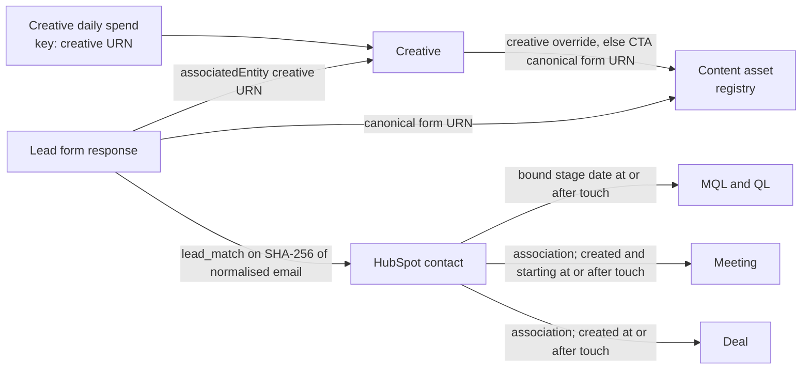

# Recommendation rules

This is the rule catalogue of the Ads Action Engine. Every action card on the `/actions` page
comes from one rule below. Each entry says when the card appears, what it says, how it ranks,
why it can be withheld or suppressed, which datasets it reads and which configuration key tunes
each number.

The catalogue is written against the same names the code uses:

- **Threshold keys** are the dotted keys of [`config/thresholds.yaml`](../config/thresholds.yaml)
  and [`config/hubspot_mapping.yaml`](../config/hubspot_mapping.yaml), written as
  `` `key` (default X) `` with the shipped default.
- **Rule ids**, **section keys**, **group keys**, **flag codes** and **finding codes** are the
  constants of `backend/src/ads_engine/analysis/context.py`.
- **Action texts** are quoted as the rule modules render them, with `{placeholders}` for the
  values each item fills in from its own evidence.

Related documents: [architecture](architecture.md) (components, schedule, data flow),
[runbook](runbook.md) (setup, simulated mode, recovery), the integration notes for
[Google Ads via n8n](integrations/google-ads-n8n.md), [LinkedIn](integrations/linkedin.md) and
[HubSpot](integrations/hubspot.md), and the [project README](../README.md).

## Contents

- [How to read this catalogue](#how-to-read-this-catalogue)
- [Shared definitions](#shared-definitions)
- [Precedence and suppression](#precedence-and-suppression)
- [Keywords to adjust (Google)](#keywords-to-adjust-google)
- [Campaigns to pause or launch](#campaigns-to-pause-or-launch)
- [Budget changes](#budget-changes)
- [Copy/creative changes (LinkedIn)](#copycreative-changes-linkedin)
- [White papers](#white-papers)
- [Evidence, flags, findings and banners](#evidence-flags-findings-and-banners)
- [Traceability](#traceability)

## How to read this catalogue

### The five sections

The page always shows five sections, in this fixed order (`SECTION_ORDER`). Within a section,
groups appear in the order shown.

| Section key | Title | Groups, in display order | Rules |
|-------------|-------|--------------------------|-------|
| `keywords` | Keywords to adjust | `block` (Block / negative-keyword candidates), `expand` (Expansion candidates), `review` (Review) | `K1`, `K2`, `K3` |
| `campaigns` | Campaigns to pause or launch | `discrepancies` (Discrepancies), `pause` (Pause), `scale` (Scale), `launch` (Launch ideas) | `C0`, `C1`, `C1b`, `C2`, `C3a`, `C3b` |
| `budget` | Budget changes | `changes` (Budget changes) | `B1`, `B2`, `B3`, `B4` |
| `creative` | Copy/creative changes | One group per campaign, keyed `campaign:{id}` | `CR1`, `CR2`, `CR3` |
| `white_papers` | White papers | One group per currency cohort, keyed `cohort:{currency}` | `W1`, `W2`, `W` |

`G1` is a guard, not a card. It removes spend increases from other rules
([G1 guard](#g1-guard)).

### The shape of an entry

Every rule entry lists the same fields. A field shared by every rule of a section, such as the
required datasets of the creative rules, is stated once at the top of that section.

- **Section and group**: where the card appears.
- **Fires when**: the exact condition, with every threshold as `` `key` (default X) ``.
- **Action**: the card headline, quoted as rendered.
- **Reason and extra output**: what the reason sentence states and what `evidence.extra`
  carries beyond the cited metrics and the card's `headline_metric`, which
  [Headline number](#headline-number) lists for every rule.
- **Ranking**: the sort order inside the group. Ties always fall back to entity name, then id.
- **Withheld or suppressed**: when a near pattern becomes a withheld line instead of a card,
  and which precedence step can remove the card.
- **Required datasets**: the datasets the rule declares (`required_datasets`). An item's
  `stale` and `incomplete` flags derive from these datasets only.
- **Decision subject**: whether the card offers "Record decision" (yes) or "Mark done" (no).
- **Acceptance tests**: the test module that proves the rule fires on one side of each
  threshold and not on the other.

### Recommend only

The product never changes anything in LinkedIn, Google Ads or HubSpot. You apply a change in the
platform yourself and record it under Decisions. The next entity sync confirms it or raises a
discrepancy ([C0](#c0-discrepancy)).

### Tuning thresholds

- Every minimum, ratio and window a rule applies is a key in `config/thresholds.yaml` or
  `config/hubspot_mapping.yaml`. No rule falls back to a value written in code, and a missing
  key fails config load.
- The parsed contents of the three files in `config/` form `config_hash`. Every analysis run
  stores it, and `GET /api/v1/config` and the `/settings` screen show it.
- Every item copies the values of the keys it applied into `evidence.thresholds`, so a card
  always shows the configuration it was computed with, even after a later edit.
- **When a change takes effect**: the worker compares `config_hash` with the latest default run
  at startup. When the hash changed, it enqueues a default-window analysis, and the next run
  applies the new values. Edit the file, then restart the worker as described in the
  [runbook](runbook.md). Editing only comments does not change the hash.
- **Config load fails** with a `ConfigError` naming the file and key when:
  - `window.presets` does not contain `window.default_days`;
  - `window.max_days` exceeds LinkedIn's 180-day daily retention, or `window.default_days`,
    `window.trusted_min_days`, `window.sustained_min_days` or a preset exceeds
    `window.max_days`;
  - `budget.under_utilization` is not below `budget.high_utilization`;
  - `k3.min_qs_days_per_span` exceeds `k3.qs_span_days`;
  - `cr.min_variants` is below 2;
  - a `crm` key appears in both `config/thresholds.yaml` and `config/hubspot_mapping.yaml`;
  - a lead form or creative is listed under two white paper assets, or a creative override
    contradicts its creative's own form. The override check runs against the synced creatives
    of the active LinkedIn dataset before each analysis run ([Asset registry](#asset-registry)).

## Shared definitions

These definitions apply to every rule that names them.

### Analysis window

- **Default window**: `window.default_days` (default 28) complete days.
  - The window ends on the latest date complete in every active source's native day: the
    earlier of yesterday in the Google account's time zone and yesterday UTC.
  - Today is always excluded as a partial day.
- **Short window**: a window shorter than `window.trusted_min_days` (default 14) raises the
  short-window banner and puts the `short_window` flag on every item (P5).
  - Each run records the `window.default_days` and `window.trusted_min_days` it was computed
    with. Its `Run` metadata (`default_days`, `trusted_min_days`, `short_window`) and its
    short-window banner use those recorded values, so a later edit to `config/thresholds.yaml`
    never changes how an earlier run's window is judged.
- **Presets**: `window.presets` (default [14, 28, 56, 90]) are the windows the window picker
  offers and the windows LinkedIn demographic segments are fetched for (`C3a`). Each preset ends
  on the default window end. The preset equal to `window.default_days` is marked "default".
- **Sustained patterns**: `K3`, `C1`, `C1b`, `C2`/`B1`, `B2`, `B3` and `B4` need a window of at
  least `window.sustained_min_days` (default 7) days. Below it they are listed as withheld with
  the observed and required days, for example "window 5 days of 7 required", or "window 1 day
  of 7 required" for a one-day window.
- **Longest window**: `window.max_days` (default 180), LinkedIn's daily analytics retention.
- **Custom windows** (`POST /runs`): end no later than the default window end, and span 1 to
  `window.max_days` days.

### Native days

- Each source's daily rows keep their native day boundary:
  - Google: `segments.date` in the customer account's time zone;
  - LinkedIn: UTC dates.
- Daily rows are never relabelled or rebucketed. A window is one calendar-date range applied to
  each source's own dates.
- Evidence lists each source's range and boundary in `source_days`, and as one sentence in
  `evidence.window.description`, for example "Google 2026-09-04 to 2026-10-01
  (America/New_York); LinkedIn same dates (UTC)". When the boundaries differ, the evidence says
  so: `evidence.window.boundaries_differ` is `true`.
- No computation combines two sources' daily rows into one daily series. Cross-source joins work
  on instants:
  - white paper spend uses LinkedIn UTC days;
  - a lead counts when its `submittedAt` falls in [start 00:00 UTC, end + 1 day 00:00 UTC);
  - HubSpot events are compared as instants.
- `DISPLAY_TIMEZONE` only formats instants for display. It never moves a day boundary.

### Outcome by source

| Source and objective group | Outcome | Objective group key |
|----------------------------|---------|---------------------|
| Google | `metrics.conversions` (a decimal; fractional under data-driven attribution) | `google` |
| LinkedIn, `LEAD_GENERATION` objective | `oneClickLeads` | `linkedin_lead_gen` |
| LinkedIn, any other objective | `externalWebsiteConversions` | `linkedin_other` |

Comparisons stay within one source and objective group, and within one currency. Amounts are
never converted or summed across currencies.

### Efficiency, baseline and expected outcomes

- **Efficiency** is cost per outcome: window spend divided by window outcomes.
- **Baseline** is the account average cost per outcome for the same source and objective group
  over the same window.
- **Expected outcomes** are an entity's spend divided by the baseline cost per outcome.

### Budget history

Entity snapshots are **observations**: each one says what a campaign's or budget's daily budget
and status were at its `captured_at` instant. It never says when a change took effect, and
observations every 3 hours cannot establish that. Each native day [day start, next day start) of
a campaign or shared budget is therefore classified from the observations around it:

- **Whole-day known**: all four hold, and the day's budget and status are that value:
  - an observation exists at or before the day start;
  - an observation exists at or after the day end;
  - every observation from the last one at or before the start through the first one at or
    after the end shows the same daily budget and status;
  - no gap between consecutive observations in that span exceeds
    `budget.max_observation_gap_hours` (default 6).

  The stated assumption is that the budget did not change and revert between two observations
  at most 6 hours apart. Evidence names it as "unchanged across N observations, at most 6 h
  apart".
- **Changed intraday**: the observations bracketing the day disagree, for example a budget
  raised at noon. The effective time is unknown, so the day has no known budget.
- **Unobserved**: a bracketing observation is missing or a gap exceeds the limit. This covers
  every day before the first snapshot, a first snapshot taken at noon, and a sync outage longer
  than the gap limit. Backfilled performance is therefore never measured against today's
  budget.

Changed-intraday and unobserved days are **unknown**. They are excluded from every utilization
and cap calculation, never assigned an observed value, and counted separately in evidence.

- A **known-budget active day** is whole-day known with status `active`.
- A **spending day** is a known-budget active day with spend > 0.
- A **known idle day** is a known-budget active day with zero spend. It is a genuine observation,
  distinct from an unknown day.

### Utilization and history gates

Utilization applies only to daily budgets: Google budgets with period `DAILY` and LinkedIn
campaigns with a `dailyBudget`. Lifetime and `CUSTOM_PERIOD` budgets show utilization "n/a" and
are excluded from the cap rules.

- **Daily utilization** u_d is the day's spend divided by the day's known daily budget, on
  known-budget active days only. A known idle day has u_d = 0.
- **Window utilization** is Σ spend ÷ Σ daily budget over the known-budget active days. Every
  budget card shows it; the predicates below use the daily ratios.
- **Daily predicates**:
  - **Capped day**: u_d ≥ `budget.capped_day_ratio` (default 0.95), or, for Google,
    `search_budget_lost_impression_share` ≥ `budget.capped_lost_is_share` (default 0.10) on
    that day.
  - **High-utilization day**: u_d ≥ `budget.high_utilization` (default 0.90).
  - **Under-utilized day**: u_d ≤ `budget.under_utilization` (default 0.50). Known idle days
    count as under-utilized.

Every history gate is measured over the known-budget active days (budget-active days for a
shared budget, see [Shared budgets](#shared-budgets)) and needs at least `budget.min_known_days`
(default 7) of them.

| Gate | Used by | Spending days required | Predicate days required |
|------|---------|------------------------|-------------------------|
| Cap-constrained | `C2`, `B1` | ≥ `budget.min_spending_days` (default 5) | Capped days ≥ `budget.min_capped_days` (default 5) and ≥ `budget.sustained_share` (default 0.70) of known-budget active days |
| High utilization | `B2`, `G1` | ≥ `budget.min_spending_days` (default 5), and ≥ `budget.sustained_share` (default 0.70) of known-budget active days | High-utilization days ≥ `budget.sustained_share` (default 0.70) of known-budget active days |
| Under-utilized | `B3` | ≥ `budget.min_spending_days` (default 5) | Under-utilized days ≥ `budget.sustained_share` (default 0.70) of known-budget active days |

Worked examples:

- One capped day followed by six idle days is 1 capped day of 7 and 1 spending day of 7. It is
  neither cap-constrained nor high-utilization.
- Ten known idle days with no spending day are idle, not under-utilized: the spending-day
  minimum keeps a budget that never serves from becoming a `B3` donor.
- 5 capped days of 7 known-budget active days (71%), with at least 5 spending days, is
  cap-constrained; 4 known-budget active days is a short history.

**Short history**: `C2`/`B1`, `B2` and `B3` judge only subjects active now: an active campaign,
or a shared budget an active campaign currently draws from. Any other subject gets neither an
item nor a withheld line. The history is short when known-budget active days fall below
`budget.min_known_days` (default 7) or spending days below `budget.min_spending_days` (default
5). A count checked against both a day minimum and a share, such as capped days against
`budget.min_capped_days` and `budget.sustained_share`, appears once among the shortfalls,
against the stricter requirement. A failed gate becomes a withheld line, with every
shortfall observed against required (for example "spending days 3 of 5 required;
known-budget days 9 of 7"), only for a near pattern:

- `C2`/`B1`: an efficient subject (cost per outcome ≤ `scale.max_cpa_ratio` (default 1.0) ×
  baseline) whose history is short, or that was capped on at least one day;
- `B2`: a subject that meets `B2`'s poor-efficiency condition and whose history is short;
- `B3`: a subject whose history is short, with at least one spending day and at least one
  under-utilized day.

Every other gate failure is not a near pattern and yields neither an item nor a withheld line:
an efficient subject with a full history and no capped day, a `B2` subject whose efficiency is
not poor, a `B3` subject with no spending day or no under-utilized day, and a share check
(`B2`'s spending or high-utilization days, `B3`'s under-utilized days) that falls short over a
history meeting both day minimums.

Every budget card (`C2`, `B1`–`B4`) shows known-budget active days, spending days, known idle
days, changed-intraday days and unobserved days; `B1`–`B4` add the spending days' share. `C2`
and `B1`–`B3` also show the days meeting the rule's predicate (with their share on `B1`–`B3`),
and `extra.gate` holds each check of their gate observed against required. `B4` is not gated
on budget history: its card has no predicate-day count, and `extra.budget_history` shows its
known-budget and spending days beside `budget.min_known_days` and `budget.min_spending_days`,
which do not gate it.

### CRM pipeline link and veto

The pipeline link judges platform outcomes against HubSpot Qualified Leads (QL).

- **LinkedIn campaigns** link through lead attribution ([White papers](#white-papers)): each
  lead's `lead_match` row in the effective CRM dataset (the simulated companion while LinkedIn is
  simulated, HubSpot's active primary dataset otherwise).
- **Google campaigns** link only when both `HUBSPOT_GOOGLE_CAMPAIGN_PROPERTY` and
  `HUBSPOT_GOOGLE_TOUCH_DATE_PROPERTY` are configured and verified against the portal at
  startup. Their population is the contacts found by touch-date discovery
  (`hubspot.google_contacts`), each counted as one matched lead at its touch date. Every
  touch-date contact in the window is one of the card's "Google touch-date contacts"; those
  whose touch is younger than `crm.lead_maturity_days` are shown apart, with the Qualified Leads
  they already reached, and never judged. Without the link, Google items carry the `no_crm_link`
  flag, no Google QL count or veto is computed, and a LinkedIn-derived subset never stands in.
  See [HubSpot integration](integrations/hubspot.md).

The veto population:

- **Matured population**: the entity's leads in the window whose touch (`submittedAt`) is at
  least `crm.lead_maturity_days` (default 14) days before the window end. Outcomes of younger
  leads never enter the veto.
- **Resolution** of each matured lead comes from its `lead_match` row: **matched** (status
  `matched`) or **unresolved** (`pending`, `no_match`, `no_email` or `error`). An unresolved lead
  stays in the population; it is never dropped.
- **Eligible contacts**: the distinct contacts behind the matched matured leads. A contact with
  repeat leads counts once, at its earliest matured touch in the window.
- **Unresolved share**: unresolved matured leads ÷ all matured leads, both counted in leads.
- **Counts shown separately**: matured leads, matched leads, unresolved leads and eligible
  contacts, beside MQL, QL and meetings. QL and meetings count only for eligible contacts and
  only for events at or after each contact's touch; meetings with an outcome in
  `crm.meeting_outcome_exclusions` (default [CANCELED]) are not counted.

The **pipeline veto fires** when all of these hold:

- eligible contacts ≥ `crm.veto_min_leads` (default 20), counted in contacts after
  de-duplication;
- unresolved share < `attribution.floor_share` (default 0.10);
- every eligible contact's evidence is known: its contact refresh, its contact-to-meeting and
  contact-to-deal association fetches, and the target reads of those meetings and deals all
  succeeded;
- the eligible contacts' QL count is 0.

The **pipeline is unavailable** for an entity when the QL stage cannot be resolved, any eligible
contact's evidence is unknown, or the unresolved share reaches `attribution.floor_share`. The
veto is then not evaluated, the item carries `pipeline_unavailable`, and a
`pipeline_unavailable` finding names the reason.

Worked example: 25 matured leads with 3 unresolved is a 12% unresolved share, so the pipeline is
unavailable even though every matched lead is fully resolved. With 2 unresolved (8%) the veto is
evaluated. Two leads from one contact count once among eligible contacts but twice in the
share's denominator.

### Ranking ties

Every group ranks by its rule's sort key. Ties are broken by entity name, then by id, so two runs
over the same data produce the same order.

## Precedence and suppression

After every rule module has returned, the runner applies one fixed order before it stores the
run (`analysis/precedence.py`):

1. **G1 guard**: remove spend increases on blocked targets.
2. **B3 allocation**: fund surviving `B1` increases from `B3` decreases.
3. **P1 discrepancies first**: pin `C0`, hold dependent items, flag the rest.
4. **P2 tracking**: suppress zero-outcome rules of a source with no recorded outcomes.
5. **P3 simulated data**: set `data_status` and the `simulated` flag.
6. **P4 stale or incomplete data**: flag items from their own required datasets.
7. **P5 short window**: flag every item of a short window.
8. **P6, P7, P8 checks**: sample minimums, no premature winners, attribution floors.
9. **Feedback suppression**: drop dismissed, snoozed and done items, except `C0`. Each `C0` item
   then leads with the number of stored items its discrepancy holds
   ([Headline number](#headline-number)).
10. **Ranking**: order each group.

Everything removed in steps 1, 4 and 9 is counted in the section's `suppressed` map
(`run_suppression`), by reason: `g1_blocked`, `tracking_absent`, `feedback_dismiss`,
`feedback_snooze` and `feedback_done`. Each section shows these counts.

### G1 guard

`G1` enforces the rule "never recommend increasing spend on high-utilization, poor-efficiency
campaigns".

- **Declared targets**: every candidate declares `increases_spend_on`, the campaigns and budgets
  whose spend it would raise:
  - the `C2` "Scale" subject and its `B1` item;
  - the campaigns a `W1` "Double down" item names.

  A `B3` reallocation only funds a `B1` increase that survived `G1`, so it never reaches a
  blocked target.
- **Blocked target**: a campaign or budget that meets the `B2` condition: the high-utilization
  gate over its known-budget active days, and poor efficiency, meaning cost per outcome ≥
  `b2.poor_efficiency_ratio` (default 1.5) × baseline, or 0 outcomes with expected outcomes ≥
  `b2.min_expected_outcomes` (default 3).
- **Shared budgets**: an increase on a shared budget, or on any of its members, is blocked when
  the budget's aggregate meets `B2`, or when any member meets the member-level predicate: the
  budget meets the high-utilization gate over its budget-active days and the member's own
  efficiency over its member days is poor, by the same `b2.*` keys.
- **Effect**: a blocked `C2` "Scale" or `B1` item is removed and counted `g1_blocked`. A blocked
  campaign is left out of a `W1` item; when no campaign remains, `W1` is withheld with "every
  contributing campaign is blocked by G1".
- **Assertion**: an independent post-check fails the run (and the tests) if any increase
  survives on a blocked target.

### B3 reallocation

The freed amount of each `B3` donor funds `B1` increases deterministically, within one source and
currency:

- **Receivers** are the campaigns or shared budgets with a `B1` item that survived `G1`. Each
  receiver's headroom is its `B1` increase.
- **Donors** (`B3` items) are taken by freed amount, descending, then entity name, then id.
  Receivers are taken in `B1` rank order: cost per outcome ascending, then name, then id.
- Each donor gives min(its remaining freed amount, the receiver's remaining headroom) to the first
  receiver with headroom left, then moves to the next receiver until its freed amount or all
  headroom is used up.
- The allocations into a receiver never exceed its `B1` increase; a runner check enforces this.
  Freed amount that is not allocated stays a plain decrease.

Worked example: two donors free 300 and 200 against one receiver whose `B1` increase is 400. The
allocations are 300 and 100, which sum to 400, and the remaining 100 of the second donor stays a
plain decrease.

A reallocation is funding for the receiver's `B1` increase, never an increase of its own:

- the `B1` card reads "Raise by {B1 increase}: {Σ allocations} funded by reallocation from
  {donors}, {remainder} from new budget" (the "from {donors}" clause is omitted when nothing was
  allocated);
- each `B3` card reads "Move {allocation} to fund {receiver}'s recommended increase (B1)" for
  each allocation.

In the example the `B1` card reads "Raise by USD 400.00: USD 400.00 funded by reallocation from
Donor A, Donor B, USD 0.00 from new budget".

### P1 discrepancies first

- `C0` items are pinned at the top of Campaigns, oldest `detected_at` first. They are exempt from
  holds, feedback and ordinary ranking.
- Every other item whose subject or input depends on a discrepant campaign or budget gets
  `held=true` with the reason "Resolve discrepancy first". Dependents are the campaign itself,
  its budget, its keywords and creatives, a shared budget containing it, and a white paper row
  whose spend comes from it. Held cards appear collapsed at the end of their group.
- The read-time overlay applies the same holds to discrepancies detected after the run
  ([Read-time overlay](#read-time-overlay)).
- While any discrepancy is unresolved, every other item carries `unverified_discrepancies`
  ("Unverified while N discrepancies are open"), with N the live count of every unresolved
  discrepancy.

### P2 tracking absent

A source with spend > 0 and zero outcomes across the window gets a `conversion_tracking_absent`
finding in each affected section: "No conversions or leads recorded — verify tracking before
acting on zero-outcome rules". For that source, `K1`, `C1`, the zero-outcome branch of `B2` and
`W2` are suppressed and counted `tracking_absent`.

### P3 to P8

- **P3 simulated data**: `data_status` is derived from the frozen provenance modes: `simulated`,
  `mixed` (a join between a live and a simulated dataset) or `live`. Simulated items carry the
  `simulated` flag ("Simulated data"), and a banner names each simulated source with its reason.
- **P4 stale or incomplete data**, per item and only from its required datasets:
  - `stale` ("Data as of …") when a required dataset last succeeded more than
    `sources.stale_after_hours` (default 24) hours ago, or its coverage stops short of the window
    end. A live item with a stale dataset gets `data_status = stale`.
  - `incomplete` when a required dataset is not `complete` over the window. Each section gets one
    `incomplete_dataset` finding per incomplete dataset it uses.
  - A successful sync of one dataset never clears the flag of another.
- **P5 short window**: the `short_window` flag on every item and the short-window banner when the
  window is below `window.trusted_min_days` (default 14).
- **P6 sample-size withholding**: a pattern below its minimum is listed under the section's
  withheld lines with its observed and required sizes. It never becomes an item.
- **P7 no premature winners**: no item calls a creative better, a winner or best unless `CR1`
  marks the pair distinguishable. Pairs that are not carry `not_distinguishable`.
- **P8 attribution floors**: the floor flags set by the white paper attribution
  (`attribution_floor`, `creative_floor`, `deal_floor`, `unknown_crm_evidence`) pass through
  unchanged ([Completeness and floors](#completeness-and-floors)).

### Feedback suppression

- Feedback matches a rule and entity. An active entry drops that rule–entity pair from later runs
  until it expires:

  | Feedback | Suppressed for | Counted as |
  |----------|----------------|------------|
  | Dismiss | `feedback.dismiss_days` (default 30) days | `feedback_dismiss` |
  | Snooze | `feedback.snooze_days` (default 7) days | `feedback_snooze` |
  | Mark done | `feedback.done_days` (default 30) days | `feedback_done` |

- `C0` is exempt: feedback on a `C0` item is refused with 422 `feedback_not_allowed`. A
  discrepancy is closed only by its resolution.
- Feedback on a historical item is refused with 409 `subject_retired`.

### Item actions

| Items | Footer actions |
|-------|----------------|
| `C1`, `C1b`, `C2` "Scale", `B1`, `B2`, `B3` | "Record decision" for the item's `decision_subject` (a campaign, or the shared budget itself), prefilled as a patch: status `paused` for `C1` and `C1b`; the proposed daily budget for `B1`, `B2`, `B3` and `C2` "Scale" (its linked `B1` amount). Also Dismiss and Snooze |
| Every other item except `C0`: `K1`, `K2`, `K3`, `C2` "Hold", `C3a`, `C3b`, `B4`, `CR1`, `CR3`, `W1`, `W2`, `W` | "Mark done", which writes `done` feedback and never a decision. Also Dismiss and Snooze |
| `C0` | The discrepancy resolver with the resolutions valid for its kind and decision shape ([C0 resolutions](#c0-resolutions)) |

### Read-time overlay

A stored run is immutable evidence. `GET /recommendations` adds current state beside it without
rewriting it:

- open discrepancies are read live, so a discrepancy detected after the run holds its dependent
  items at once and the banner count is always current;
- source modes, active datasets and dataset freshness are read live, so `current.flags_now` and
  `current.data_status_now` reflect the sources now;
- feedback is read live (`current.hidden_by`);
- an item whose provenance datasets are no longer active is `current.historical`, held with
  "Computed from data that has since been replaced", and every action on it is disabled. Its
  original `evidence.provenance` stays as computed.

## Keywords to adjust (Google)

Section `keywords`. Search terms come from the `search_term_view` report and keywords from the
account's keyword list and `keyword_view` daily facts.

**Every keyword card shows**, in this order: the term (or keyword text), spend, conversions,
cost per conversion ("—" when conversions are 0) and the reason. The campaign and ad group sit
beside them in `evidence.extra`. Conversions are decimals throughout, because data-driven
attribution makes them fractional. Reasons, findings and withheld lines put a count's noun in
the singular only at exactly 1 ("1 conversion", "1 click", "window 1 day of 14 required").

**Search-term coverage**: the section carries one `search_term_coverage` finding per Google
account, search-term spend ÷ keyword spend over the window. Google withholds low-volume search
terms for privacy, so search-term totals fall below keyword totals. When coverage is below
`keywords.min_search_term_coverage` (default 0.80), every `K1`, `K2` and `K3` item of the account
carries the `search_term_coverage` flag ("Low search-term coverage: {percent}% of keyword
spend"). The finding states the minimum exactly as configured (0.80 → "80%", 0.8858 →
"88.58%"). The percentage shows one decimal place and the evidence share (`coverage_share`)
four, with more places only where fewer would put them on the other side of the minimum than
the exact comparison: a share of 0.884654 against a minimum of 0.8848 reads "88.47%", never
"88.5%". The finding, its evidence, the flag and each item's `evidence.extra` show the same
percentage.

**CRM link**: without the verified Google-to-CRM link
([CRM pipeline link and veto](#crm-pipeline-link-and-veto)), every `K1`, `K2` and `K3` item also
carries the `no_crm_link` flag, after its other flags. The section emits no `no_crm_link`
finding.

### K1 Block / negative candidate

- **Section and group**: `keywords` → `block`.
- **Fires when** a search term in the window has all of:
  - status `NONE` or `ADDED` (`EXCLUDED` and `ADDED_EXCLUDED` terms are already blocked and
    skipped);
  - exactly 0 conversions (any fractional conversion counts as converting);
  - clicks ≥ n\* (the click gate below);
  - spend ≥ `k1.min_spend_cpa_multiple` (default 1.0) × the account cost per conversion over the
    window, so at least one typical conversion's cost was spent.
- **Click gate n\***:
  - r = account conversions ÷ clicks over the trailing `k1.baseline_days` (default 90) days,
    ending at the window end.
  - n\* = max(`k1.min_clicks_floor` (default 10), ⌈`k1.rule_of_three` (default 3) ÷ r⌉), with no
    upper cap.
  - r is a rate, not a per-click probability: data-driven attribution makes conversions
    fractional and `MANY_PER_CLICK` actions allow several conversions per click, so r can reach
    or exceed 1. The gate is therefore labelled "Minimum clicks for the account's conversion
    rate", and no probability is claimed.

  | Account rate r | n\* |
  |----------------|-----|
  | 1% (0.01) | ⌈3 ÷ 0.01⌉ = 300 |
  | 0.1% (0.001) | ⌈3 ÷ 0.001⌉ = 3,000 |
  | 4.7% (0.047, fractional data-driven baseline) | ⌈63.8…⌉ = 64 |
  | 0.3 or more, including r = 1 and r = 1.4 | the 10-click floor |

- **Action**: "Add as exact-match negative". `K1` never recommends pausing a keyword; keyword
  problems belong to `K3`.
- **Reason and extra output**: wasted spend (= spend), clicks, conversions, the matched keyword
  and n\*, against the account rate, the account cost per conversion and the spend floor (the
  `min_spend` baseline: `k1.min_spend_cpa_multiple` × the account cost per conversion, rounded
  half-even at the minor unit like the spend): "Spent {spend} over {days} days with 0
  conversions across {clicks} clicks, at or above the minimum of {n\*} clicks for the account's
  conversion rate of {r} (conversions ÷ clicks), and {spend gate}." At the default multiple of
  1 the spend gate reads "at least 1x the account cost/conversion of {cost per conversion}";
  at any other multiple it reads "at or above the spend floor of {floor} ({multiple}x the
  account cost/conversion)", because a multiple of the rounded cost per conversion can exceed
  the spend that met the exact floor (14 × 1.43 = 20.02 against a spend and floor of 20.00).
  For an `ADDED` term the reason adds "The term is already a keyword: {text} ({match type},
  criterion {criterion id}). An exact-match negative also blocks that keyword's exact-match
  traffic."
- **Ranking**: spend, descending.
- **Withheld or suppressed**:
  - a term below the click gate is withheld with clicks observed and required, for example
    "clicks 63 of 64 required";
  - `K1` is withheld account-wide with the `k1_no_baseline` finding when the baseline has fewer
    than `k1.min_baseline_conversions` (default 10) conversions, or r is 0 or unavailable;
  - `K1` is withheld account-wide when the account cost per conversion over the window is
    unavailable ("account cost/conversion unavailable: …");
  - P2 suppresses `K1` for an account with spend and no recorded conversions.
- **Required datasets**: `google.search_terms`, `google.metrics_daily`. P4 judges
  `google.metrics_daily` over the trailing baseline as well as the window, because the account
  rate r reads it.
- **Decision subject**: no ("Mark done").
- **Acceptance tests**: `backend/tests/acceptance/test_keywords_rules.py`.

### K2 Expansion candidate

- **Section and group**: `keywords` → `expand`.
- **Fires when** a search term in the window has:
  - status `NONE` (neither a keyword nor excluded);
  - conversions ≥ `k2.min_conversions` (default 3), which avoids one-off conversions;
  - cost per conversion ≤ `k2.max_cpa_ratio` (default 1.0) × its campaign's cost per conversion,
    so it is at or better than campaign efficiency.
- **Action**: "Add as phrase-match keyword in {ad group}".
- **Reason and extra output**: conversions, cost per conversion and the campaign's cost per
  conversion: "{conversions} conversions at {cost per conversion} per conversion over {days}
  days, at or below {efficiency gate}." At the default ratio of 1 the efficiency gate reads
  "1x the campaign's {campaign cost per conversion} per conversion"; at any other ratio it reads
  "the highest qualifying cost/conversion of {maximum} ({ratio}x the campaign's
  cost/conversion)", citing the `max_cost_per_conversion` baseline the term was compared with.
  The reason then lists the adjacent terms in `extra.adjacent_terms`:
  - up to `k2.adjacent_max_terms` (default 5) other window search terms;
  - token Jaccard similarity ≥ `k2.adjacent_jaccard` (default 0.5), lowercased with stopwords
    removed;
  - not already keywords, not excluded, and with clicks ≥ `k2.adjacent_min_clicks` (default 1);
  - ordered by conversions, then clicks;
  - labelled "from your search-term report", because they come from the account's own report.
- **Ranking**: conversions, descending, then cost per conversion, ascending.
- **Withheld or suppressed**: a `NONE` term at or better than campaign efficiency but below the
  conversion minimum is withheld with conversions observed and required, for example
  "conversions 2 of 3 required" (fractional values shown exactly).
- **Required datasets**: `google.search_terms`, `google.metrics_daily`, `google.entities`.
- **Decision subject**: no ("Mark done").
- **Acceptance tests**: `backend/tests/acceptance/test_keywords_rules.py`.

### K3 Review

- **Section and group**: `keywords` → `review`.
- **Fires when**:
  - the window has at least max(`k3.min_window_days` (default 14), `window.sustained_min_days`
    (default 7)) days, split into two halves;
  - the keyword has clicks ≥ `k3.min_clicks_per_half` (default 30) in each half, for a stable
    CPC;
  - and either branch fires:
    - **(a) Quality score**: the mean daily `historical_quality_score` over the last
      `k3.qs_span_days` (default 7) days ≤ the mean over the first `k3.qs_span_days` days −
      `k3.qs_drop` (default 1), with daily scores present on ≥ `k3.min_qs_days_per_span`
      (default 5) days in each span. A one-point drop on the integer 1–10 scale is material.
      Only when daily scores are absent altogether are the keyword's quality-score snapshots at
      window start and end compared instead. Scores present on too few days do not fall back to
      snapshots: the branch does not fire.
    - **(b) Rising CPC without a matching rise in conversion**: CPC second half ÷ first half ≥
      `k3.rise_ratio` (default 1.15), and either cost per conversion second half ÷ first half ≥
      `k3.rise_ratio`, or second-half conversions are 0 while first-half conversions are ≥
      `k3.min_first_half_conversions` (default 1). 15% is above normal auction noise.
- **Action**: "Review keyword: bid, match type or landing page".
- **Reason and extra output**: quality score first against last (daily means or snapshots), CPC
  by half, cost per conversion by half, conversions and clicks by half, each with its dates.
- **Ranking**: window spend, descending.
- **Withheld or suppressed**:
  - a window shorter than the minimum withholds `K3` for the run ("window {days} days of
    {required} required", or "window 1 day of {required} required" for a one-day window);
  - a keyword showing a pattern below the click minimum is withheld, for example "clicks 29 of
    30 required in the first half (2026-09-04 to 2026-09-17)";
  - a keyword that clears the click gate but has daily quality scores on too few days is
    withheld ("quality score on 4 of 5 required days in the first 7 days"), unless branch (b)
    fires.
- **Required datasets**: `google.metrics_daily`, `google.entities`, `google.search_terms`.
- **Decision subject**: no ("Mark done").
- **Acceptance tests**: `backend/tests/acceptance/test_keywords_rules.py`.

## Campaigns to pause or launch

Section `campaigns`. Groups appear in this order: `discrepancies`, `pause`, `scale`, `launch`.

**CRM datasets of a pipeline population.** `C1`, `C1b` and `C2` read the veto population's
datasets whenever they show pipeline evidence. For a LinkedIn campaign these are
`linkedin.leads`, `hubspot.contacts` and `hubspot.associations` of the effective CRM dataset. For
a Google campaign with a verified CRM link they are `hubspot.google_contacts`,
`hubspot.contacts` and `hubspot.associations` of HubSpot's active primary dataset. They are
listed below as "the CRM datasets".

### C0 Discrepancy

- **Section and group**: `campaigns` → `discrepancies`.
- **Fires when** a subject's newest snapshot differs from its current decision. Subjects are
  campaigns and Google explicitly shared budgets; campaign groups are snapshotted and shown in
  evidence but are not decision subjects. The comparison runs after every entity sync, and every
  unresolved discrepancy (`open` or `awaiting_platform`) becomes one item. Kinds:
  - `status`: the normalised status (`active`, `paused` or `ended`) differs;
  - `budget`: any amount differs at native precision, or a shared member's budget assignment
    differs. Google compares `amount_micros` with the decided amount converted exactly to
    micros; LinkedIn compares at the currency's minor unit. There is no tolerance, and decisions
    are validated to the same unit, so rounding can neither cause nor hide a mismatch;
  - `untracked`: an entity first seen after its dataset's baseline, with no decision;
  - `missing`: a tracked entity the platform no longer returns. It is raised only after a
    complete enumeration (every Google keyset page and id re-read succeeded, or LinkedIn's
    all-status search finished); an incomplete read infers nothing and the previous snapshot
    stands.
- **No false discrepancies on day one**: the first entity sync of each new dataset writes the
  current platform state as the baseline decision (`origin=baseline`) for every campaign and
  every shared budget, each in its own decision shape.
- **Action**: "Resolve: platform shows {platform}, last decided {decided}". Values render as, for
  example, "daily budget USD 50.00", "shared budget 123", "not returned by the platform", "no
  decision recorded" or "removed (acknowledged)". An `awaiting_platform` item adds "Awaiting a
  matching platform snapshot."
- **Reason and extra output**: the `platform` and `decided` metrics side by side, followed by
  the headline `held_recommendations`, which precedence appends once every hold is final
  ([Headline number](#headline-number)); `extra` holds the discrepancy id, kind, decision shape,
  state, `detected_at`, both raw values and `resolutions`, exactly the resolutions valid for its
  kind and decision shape (below).
- **Ranking**: pinned first in Campaigns, oldest `detected_at` first.
- **Withheld or suppressed**: never held, never hidden by feedback, never suppressed.
- **Flags**: the item of a Google subject carries `no_crm_link` without the verified
  Google-to-CRM link; a LinkedIn subject's item never does.
- **Required datasets**: `google.entities` or `linkedin.entities`, the subject source's entity
  dataset.
- **Decision subject**: no. The card shows its resolver instead of "Record decision".
- **Acceptance tests**: `backend/tests/acceptance/test_campaign_rules.py`.

#### C0 resolutions

The API keys are `platform_correct`, `decision_correct`, `adopt_platform`, `record_intended` and
`acknowledge_removal`. `ads_engine.decisions.RESOLUTIONS` defines exactly eleven valid (kind,
decision shape) pairs; any other combination is refused with 422. There is no (`status`,
`budget`) pair, because a shared budget has no status.

| Kind | Decision shapes | Resolutions offered |
|------|-----------------|---------------------|
| `status` | `own_budget`, `shared_member` | `platform_correct`, `decision_correct` |
| `budget` | `own_budget`, `shared_member` (its budget assignment), `budget` | `platform_correct`, `decision_correct` |
| `untracked` | `own_budget`, `shared_member`, `budget` | `adopt_platform`, `record_intended` |
| `missing` | `own_budget`, `shared_member`, `budget` | `acknowledge_removal`, `decision_correct` |

Effects:

- `platform_correct` (`status`, `budget`): writes a decision that adopts the platform value (the
  status, the amount, or a member's new `budget_id`), keeps the rest of the shape, and closes at
  once. Budget subjects have no status, so no status is read or written for them.
- `decision_correct` (`status`, `budget`, `missing`): writes nothing and sets
  `awaiting_platform`. The discrepancy closes when a later snapshot matches the decision; for
  `missing`, when a complete enumeration returns the entity and its snapshot matches.
- `adopt_platform` (`untracked`): writes the platform state in the subject's shape and closes at
  once.
- `record_intended` (`untracked`): takes `intended_state` in the subject's shape, writes it and
  waits as `awaiting_platform`:
  - `own_budget`: `{status, daily_budget?, total_budget?}` with the budget fields the campaign
    has;
  - `shared_member`: `{status}`;
  - `budget`: exactly one amount, `{daily_budget}` for a `DAILY` budget or `{total_budget}` for
    `CUSTOM_PERIOD`, and no status. Anything else is refused with 422.
- `acknowledge_removal` (`missing`): writes a tombstone decision (`tombstone=true`; a campaign
  also gets status `ended`) and resolves at once, never waiting for a snapshot, because a removed
  entity may never produce one. While the entity stays absent, no new `missing` discrepancy is
  raised. A reappearance is a complete enumeration that later returns the entity, in a snapshot
  captured after the tombstone; it raises one discrepancy against the tombstone, resolved through
  the `status` or `budget` row of the table above. No snapshot ever matches a tombstone:
  `platform_correct` writes the whole platform state, which clears the tombstone, and an `open`
  or `awaiting_platform` reappearance closes by itself when a later complete enumeration again
  omits the entity. The kind follows the subject:
  - a campaign (`own_budget` or `shared_member`) raises a `status` discrepancy whatever status it
    is returned with, `ended` included, or with no status reported;
  - a shared budget (`budget`) has no status, so it raises a `budget` discrepancy that compares
    the tombstoned amount with the platform's amount.
- **Auto-resolution**: every `status`, `budget` and `untracked` discrepancy in `open` or
  `awaiting_platform` closes by itself when a later snapshot matches the current decision,
  re-checked on every entity sync. `missing` closes only through `acknowledge_removal`, or
  through a matching snapshot after `decision_correct`.

#### Decision shapes and patch rules

The subject's current state fixes its decision shape, and its expected state holds only the
fields that subject owns:

| Shape | Applies to | Expected state | What `C0` compares |
|-------|------------|----------------|--------------------|
| `own_budget` | A LinkedIn campaign; a Google campaign whose budget is not explicitly shared | Status, plus the budget fields the campaign has: LinkedIn `daily_budget` and/or `total_budget`; Google `daily_budget` for a `DAILY` period, `total_budget` for `CUSTOM_PERIOD` | Status and those amounts |
| `shared_member` | A Google campaign drawing from an explicitly shared budget | Status, plus `budget_id`; never an amount | Status and budget assignment |
| `budget` | A Google explicitly shared budget | Exactly one amount, the one its period allows; no status | The amount |

A change to a shared budget's amount therefore raises at most one discrepancy, on the budget
subject, and never one on its members.

- A decision is submitted as a **patch** carrying only the fields being decided. The server
  applies it over the subject's last decided state and writes one complete, append-only row, so a
  budget-only decision keeps the decided status and a status-only decision keeps the decided
  budget.
- A patch is refused with **422** when it:
  - is empty, or changes nothing;
  - carries an amount finer than the currency's minor unit (Google: a whole number of micros);
  - on `own_budget`, sets a daily budget on a campaign without one, a total budget on a campaign
    without a lifetime budget, or, for Google, the field that does not match the budget period;
  - on `shared_member`, carries any amount; the error names the shared budget that owns it. A
    member's assignment changes only through a discrepancy resolution;
  - on `budget`, carries `status`, carries both `daily_budget` and `total_budget`, or carries the
    field that does not match the period.
- A decision or resolution on a subject whose dataset is not active is refused with **409**
  `subject_retired`.

### C1 Pause

- **Section and group**: `campaigns` → `pause`.
- **Fires when** an active campaign of either source has all of:
  - a window of at least max(`c1.min_window_days` (default 14), `window.sustained_min_days`
    (default 7)) days;
  - spend on ≥ `c1.min_spend_day_share` (default 0.70) of the window days ("spending steadily");
  - exactly 0 outcomes;
  - expected outcomes ≥ `c1.min_expected_outcomes` (default 3). At a Poisson mean of 3, P(0) ≈ 5%,
    so zero output at that spend is very unlikely to be bad luck.
- **Action**: "Pause".
- **Reason and extra output**: "Spent {spend} on {spend days} of {window days} days with 0
  {outcomes}; at the account's {baseline} per {outcome}, {expected} {outcomes} were expected."
  The card shows spend, days with spend, expected outcomes, the baseline cost per outcome and,
  when the CRM is linked, the veto counts (matured, matched, unresolved, eligible, MQL, QL,
  meetings). A LinkedIn campaign names its campaign group in `extra.campaign_group`.
- **Ranking**: spend, descending.
- **Withheld or suppressed**:
  - a short window withholds `C1` for the run ("window {days} days of {required} required",
    or "window 1 day of {required} required" for a one-day window);
  - zero outcomes on steady spend with too few expected outcomes, for example "expected
    conversions 2.9 of 3 required";
  - enough expected outcomes on too few spending days, for example "spend days 16 of 20 required
    (70% of 28 window days)";
  - P2 suppresses `C1` for a source with spend and no recorded outcomes.
- **Required datasets**: `google.entities` and `google.metrics_daily`, or `linkedin.entities` and
  `linkedin.analytics_daily`; plus the CRM datasets when pipeline evidence is shown.
- **Decision subject**: yes, the campaign. "Record decision" is prefilled with status `paused`.
- **Acceptance tests**: `backend/tests/acceptance/test_campaign_rules.py`.

### C1b Pipeline pause (LinkedIn)

- **Section and group**: `campaigns` → `pause`.
- **Fires when** an active LinkedIn campaign has all of:
  - a window of at least max(`c1b.min_window_days` (default 28), `window.sustained_min_days`
    (default 7)) days;
  - eligible contacts ≥ `crm.veto_min_leads` (default 20) from the matured population
    ([CRM pipeline link and veto](#crm-pipeline-link-and-veto));
  - QL = 0 and meetings = 0 for those contacts (meetings with an outcome in
    `crm.meeting_outcome_exclusions` are not counted);
  - the pipeline is available, the unresolved share is below
    `attribution.floor_share` (default 0.10), and no eligible contact's CRM evidence is unknown.
- **Action**: "Pause or rework targeting: leads are not becoming Qualified Leads".
- **Reason and extra output**: "{eligible} eligible contacts from {matured} matured leads reached
  0 Qualified Leads and 0 meetings (MQL {mql}) after {spend} of spend in the window." The card
  shows leads, matured leads, matched and unresolved matured leads, eligible contacts, MQL, QL
  and meetings side by side.
- **Ranking**: spend, descending.
- **Withheld or suppressed**: a zero under a floor or unknown evidence may be an artefact of
  unmatched contacts or failed association reads, so the campaign is withheld instead, with a
  `pipeline_unavailable` finding where the pipeline is unavailable:
  - "eligible contacts 19 of 20 required";
  - "attribution floor: {share} of matured leads unresolved in HubSpot (floor {floor share})";
  - "unknown CRM evidence for {n} of {eligible} eligible contacts";
  - "pipeline unavailable: {reason}";
  - a short window withholds `C1b` for the run.
- **Required datasets**: `linkedin.leads`, `linkedin.analytics_daily`, `hubspot.contacts`,
  `hubspot.associations`, `linkedin.entities`. The `hubspot.*` datasets are those of the
  effective CRM dataset.
- **Decision subject**: yes, the campaign. "Record decision" is prefilled with status `paused`.
- **Acceptance tests**: `backend/tests/acceptance/test_campaign_rules.py`.

### C2 Scale or Hold

`C2` and `B1` share one evaluation, so they can never disagree.

- **Section and group**: `campaigns` → `scale`.
- **Eligibility**: an active budget subject (a campaign, or a Google shared budget) with all of:
  - a window of at least `window.sustained_min_days` (default 7) days;
  - the cap-constrained gate ([Utilization and history gates](#utilization-and-history-gates)),
    including its known-day and capped-day minimums;
  - window outcomes ≥ `scale.min_outcomes` (default 5);
  - cost per outcome ≤ `scale.max_cpa_ratio` (default 1.0) × the baseline for its source and
    objective group;
  - no `G1` block on the subject or on a campaign the increase would raise.
- **Outcome for an eligible subject**: the pipeline veto is evaluated separately, so a Hold is
  always emitted when the veto fires.
  - Veto passes: "Scale", plus a `B1` item that carries the amount.
  - Veto fires: "Hold: platform outcomes are not reaching Qualified Lead", and no `B1` item.
  - Pipeline unavailable, or a Google campaign without a CRM link: "Scale" plus `B1`, flagged
    `pipeline_unavailable` or `no_crm_link`.
- **Action**: "Scale" or "Hold: platform outcomes are not reaching Qualified Lead".
- **Reason and extra output**:
  - Scale: "Capped on {capped} of {known} known-budget days with {outcomes} {outcomes label} at
    {cost} per {outcome} (account {baseline}): raise the daily budget from {current} to
    {proposed} (B1)." A shared budget counts budget-active days instead of known-budget days.
    `extra.b1_link` points to the `B1` item.
  - Hold: "…, but {eligible} eligible contacts from matured leads reached 0 Qualified Leads: hold
    the budget." The card shows matured, matched and unresolved leads, eligible contacts, MQL, QL
    and meetings.
  - Both show spend, outcomes, expected outcomes, cost per outcome and the budget-history day
    counts. A shared budget lists its members in `extra.members` and carries `shared_budget`.
- **Ranking**: cost per outcome, ascending.
- **Withheld or suppressed**:
  - an efficient subject whose window, history or outcomes fall short is withheld with observed
    against required, for example "known-budget days 4 of 7 required";
  - members spanning more than one objective group or currency make efficiency "n/a" and the
    subject is withheld;
  - a subject with full history and no capped day is simply not cap-constrained and not listed;
  - `G1` removes a blocked "Scale" (and its `B1`), counted `g1_blocked`.
- **Required datasets**: the subject source's entity and daily metrics datasets (`google.entities`
  and `google.metrics_daily`, or `linkedin.entities` and `linkedin.analytics_daily`), plus the CRM
  datasets when a veto population is read.
- **Decision subject**: "Scale" yes, the campaign or the shared budget itself, prefilled with the
  linked `B1` amount. "Hold" no ("Mark done").
- **Acceptance tests**: `backend/tests/acceptance/test_campaign_rules.py`.

### C3a Launch: underused proven segment (LinkedIn)

- **Section and group**: `campaigns` → `launch`.
- **Scope**: `C3a` is evaluated only while at least one LinkedIn campaign is active (status
  `active`, any objective). With none, it produces nothing at all: no card, no withheld line and
  no `segment_window_unavailable` finding, even when no segment window matches the run window.
- **Fires when** a demographic value (job function, seniority or industry) inside an active
  LinkedIn campaign with the `LEAD_GENERATION` objective has all of:
  - segment leads ≥ `c3a.min_leads` (default 5);
  - segment cost per lead ≤ `c3a.max_cpl_ratio` (default 0.8) × the campaign's cost per lead;
  - segment impression share of the campaign < `c3a.max_impression_share` (default 0.15).

  It does not fire when the pivot returns no lead metric. Only lead-generation campaigns are
  evaluated, because the campaign's cost per lead is its window spend ÷ its `oneClickLeads`:
  segments of a campaign with any other objective are skipped, with no card and no withheld line.
  An active campaign of another objective still brings `C3a` into scope, so the segment window
  check below still applies.
- **Skipped**, with no card and no withheld line:
  - a segment row whose leads are unavailable or 0, or whose cost or impressions are
    unavailable; a pivot without a lead metric gives such rows;
  - every segment of a campaign whose cost per lead is unavailable, because its window
    `oneClickLeads` are unavailable or 0, or whose window impressions are 0. Window totals
    report leads only when every counted daily row reports them, so one unreported day, or no
    daily row in the window, makes them unavailable.
- **Segment windows**: LinkedIn approximates and privacy-thresholds demographic values, so
  segments are fetched as aggregates for each preset in `window.presets`, each ending on the
  default window end. `C3a` is evaluated only when the run window equals one of those fetched
  windows. Otherwise, within the scope above, it is withheld with the
  `segment_window_unavailable` finding and one of two labels, and never reuses another window's
  segments:
  - a preset not yet fetched for the current end date: "Segment data for the {n}-day window
    ending {end} not yet available; latest available ends {date}", where {date} is `none` when
    no segment window has been fetched;
  - a custom window whose length is not a preset or whose end is not the default end: "Segment
    data exists only for the preset windows {list} ending {end}".
- **Action**: "Launch a campaign targeting {facet}: {value} with {campaign}'s offer".
- **Reason and extra output**: segment leads, spend and cost per lead against the campaign's cost
  per lead; segment and campaign impressions and the impression share; campaign spend and leads;
  the campaign group in `extra.campaign_group`.
- **Ranking**: segment leads, descending.
- **Withheld or suppressed**:
  - a run window with no matching segment data withholds `C3a` for the run: one
    `segment_window_unavailable` finding and one withheld line, each carrying its case's label.
    Neither names an entity, and the line has no sample size: its `observed` and `required` are
    null and its unit is `segment windows`;
  - otherwise each segment not skipped above meets three gates in order and stops at the first
    it fails. First, a cost per lead above `c3a.max_cpl_ratio` × the campaign's, or an
    impression share at or above `c3a.max_impression_share`, leaves the segment unlisted;
  - second, a segment otherwise underused and efficient but below the lead minimum is withheld
    with leads observed and required ("segment leads 4 of 5 required");
  - third, a campaign with window leads but zero window spend has a cost per lead of 0, which
    gives no cost baseline, and the segment-to-campaign ratio is never fabricated. A zero-cost
    segment that meets the share and lead minimums is withheld with "no exposure: zero campaign
    spend in the window, so segment cost per lead cannot be compared", observed 0 of 1 required
    in the unit `campaign days with spend`. A segment with any cost is dearer than the zero
    baseline, so it fails the first gate and is not listed. A zero-cost segment below the lead
    minimum gets the lead-minimum line instead, for example "segment leads 20 of 21 required" at
    `c3a.min_leads` 21.
- **Required datasets**: `linkedin.segments`, `linkedin.analytics_daily`, `linkedin.entities`.
- **Decision subject**: no ("Mark done").
- **Acceptance tests**: `backend/tests/acceptance/test_campaign_rules.py`.

### C3b Launch: keyword cluster without a campaign (Google)

- **Section and group**: `campaigns` → `launch`.
- **Fires when**:
  - the window's converting Google search terms (any conversion above 0) are grouped by single
    linkage at token Jaccard ≥ `c3b.jaccard` (default 0.5), lowercased with stopwords removed;
  - a cluster's head tokens are the tokens present in ≥ `c3b.head_token_share` (default 0.5) of
    its member terms;
  - the cluster has ≥ `c3b.min_terms` (default 3) converting terms and ≥ `c3b.min_conversions`
    (default 5) conversions in total;
  - its head tokens appear in no keyword text, ad group name or campaign name.
- **Action**: "Create ad group or campaign for '{head tokens}'". The head tokens follow the
  member terms' word order: for each pair of head tokens a member contains, the one it uses
  first earns a point, and tokens are listed by points, most first, then alphabetically on a tie
  (members "revenue forecasting tool" and "b2b revenue forecasting" give "revenue forecasting").
  `extra.head_tokens` and the cluster's entity key keep them in alphabetical order.
- **Reason and extra output**: "{n} converting search terms cluster around the words
  '{head tokens}' with {conversions} conversions at {cost} per conversion; no keyword, ad group
  or campaign name contains those words." The card lists the member terms with their spend and
  conversions.
- **Ranking**: cluster conversions, descending.
- **Withheld or suppressed**: an uncovered cluster below a minimum is withheld with its size, for
  example "converting search terms 2 of 3 required" or "conversions 4 of 5 required".
- **Flags**: without the verified Google-to-CRM link the item carries `no_crm_link` and counts
  in the Campaigns `no_crm_link` finding.
- **Required datasets**: `google.search_terms`, `google.entities`.
- **Decision subject**: no ("Mark done").
- **Acceptance tests**: `backend/tests/acceptance/test_campaign_rules.py`.

No rule other than `C3a` and `C3b` produces launch ideas.

## Budget changes

Section `budget`, one group `changes`. Every item is ranked by window spend, descending, and the
withheld patterns follow the items.

**Every budget card shows, side by side**:

- utilization: the window percentage plus every day count from
  [Utilization and history gates](#utilization-and-history-gates), each observed against
  required where the rule's gate sets a requirement (known-budget or budget-active days,
  spending days, days meeting the rule's predicate, idle days, changed-intraday days,
  unobserved days). `B4` shows the same counts beside its pattern but no days meeting a
  predicate, because it is not gated on budget history;
- efficiency: cost per outcome against the account baseline;
- outcomes, and CRM Qualified Leads where linked;
- the latest effective daily budget and the exact window with each source's day boundary. `B1`
  and `B3` cards also show the proposed daily budget, and a `B2` card shows it only when the
  latest effective daily budget is known; `B4` proposes no amount.

**Required datasets of every budget rule**: the subject source's entity dataset (snapshots and,
for Google, conversion-action settings) and daily metrics dataset, plus the CRM datasets when
Qualified Leads are shown:

- Google: `google.entities`, `google.metrics_daily`; with a verified CRM link also
  `hubspot.google_contacts`, `hubspot.contacts`, `hubspot.associations`;
- LinkedIn: `linkedin.entities`, `linkedin.analytics_daily`; with CRM evidence also
  `linkedin.leads`, `hubspot.contacts`, `hubspot.associations` of the effective CRM dataset.

**Decision subjects**: `B1`, `B2` and `B3` write the campaign, or the shared budget itself. `B4`
has none ("Mark done").

**Acceptance tests**: `backend/tests/acceptance/test_budget_rules.py`.

### Shared budgets

A Google budget with `explicitly_shared` is evaluated at budget level, and the budget itself is
the subject. Items on it carry the `shared_budget` flag and list every member campaign with its
member days.

- **Dated membership**: a campaign belongs to the budget on day d when its campaign snapshots
  bracketing d (the observation rule in [Budget history](#budget-history)) all show this
  `budget_id`. Membership is evaluated day by day from snapshot history, never from today's
  member list, so a campaign that joined or left mid-window counts only on its member days.
- **Budget-active day**: a budget has no status, so day d is budget-active when all hold:
  - the budget's amount is whole-day known on d;
  - the membership of every campaign that showed this `budget_id` in any observation bracketing
    d is whole-day known, so no campaign changed budgets during d;
  - at least one member is whole-day known with status `active` on d.

  Budget-active days replace known-budget active days in every gate. A spending day is a
  budget-active day with member spend > 0; an idle day has zero member spend.
- **Aggregation**: the day's spend is the sum over that day's members only, and daily
  utilization divides it by the shared amount, the only cap the members have. Outcomes and cost
  per outcome are aggregated over member days and compared with the account baseline for the
  members' source and objective group.
- **Mixed objective groups**: when members span more than one objective group, efficiency is
  "n/a" and `B1`, `B2` and `B3` are withheld for that budget.
- **G1 member-level predicate**: a member meets `B2` within the shared budget when the budget
  meets the high-utilization gate over its budget-active days and the member's own efficiency
  over its member days is poor (cost per outcome ≥ `b2.poor_efficiency_ratio` × baseline, or 0
  outcomes with expected outcomes ≥ `b2.min_expected_outcomes`). `G1` then blocks every increase
  on the budget, and every `W1` or `C2` increase naming any member.
- **No member items**: member campaigns get no individual increase or decrease items. A decision
  on the item writes the budget subject; a member's own decision has the `shared_member` shape
  (status and assignment, never an amount), so a change to the shared amount never creates a
  discrepancy on a member.

### B1 Increase

- **Section and group**: `budget` → `changes`.
- **Fires when** `C2` returns "Scale" for the subject ([C2 Scale or Hold](#c2-scale-or-hold)). No
  `B1` exists under a veto "Hold".
- **Thresholds**: `b1.step` (default 0.20), a bounded step that lets the next window measure the
  response, plus every `C2` eligibility key (`scale.*`, `budget.*`, `window.sustained_min_days`).
- **Action**: "Raise daily budget from {current} to {proposed}". {current} is the latest
  effective daily budget and {proposed} = {current} × (1 + `b1.step`), that is {current} × 1.2 by
  default, rounded to the currency's minor unit.
- **Reason and extra output**: the cap evidence and efficiency of `C2`. `extra.funding` always
  holds the funding sentence ("Raise by {B1 increase}: {Σ allocations} funded by reallocation
  from {donors}, {remainder} from new budget"), and the reason adds it when some of the increase
  is funded by `B3` reallocation ([B3 reallocation](#b3-reallocation)).
- **Ranking**: window spend, descending.
- **Withheld or suppressed**: withheld exactly when `C2` is; removed by `G1` on a blocked target
  (counted `g1_blocked`).
- **Required datasets**: see the section rules above.
- **Decision subject**: yes, prefilled with the proposed daily budget.

### B2 Do not increase: high utilization, poor efficiency

- **Section and group**: `budget` → `changes`.
- **Fires when**, for an active subject (an active campaign, or a shared budget an active
  campaign currently draws from), the window has at least `window.sustained_min_days` (default 7)
  days and:
  - the high-utilization gate passes: at least `budget.min_known_days` (default 7) known-budget
    active days, at least `budget.min_spending_days` (default 5) spending days making up ≥
    `budget.sustained_share` (default 0.70) of them, and high-utilization days (u_d ≥
    `budget.high_utilization`, default 0.90) on ≥ `budget.sustained_share` of them;
  - and efficiency is poor: cost per outcome ≥ `b2.poor_efficiency_ratio` (default 1.5) ×
    baseline, or 0 outcomes with expected outcomes ≥ `b2.min_expected_outcomes` (default 3).
- **Action**: "Do not increase. Lower daily budget by {step} or fix efficiency first", with
  {step} rendered from `b1.step` ("Do not increase. Lower daily budget by 20% or fix efficiency
  first" by default). The decrease reuses the `B1` step, so a raise and a cut are the same
  configured size.
- **Reason and extra output**: the high-utilization day counts, efficiency against baseline and
  the lowered budget. `extra.branch` names the branch that fired (`poor_efficiency` or
  `zero_outcomes`).
- **Effect on other rules**: `G1` blocks every increase on the target. A `C1` pause can still
  appear.
- **Ranking**: window spend, descending.
- **Withheld or suppressed**:
  - a failed high-utilization gate is withheld, with every shortfall, only when efficiency is
    poor (either branch) and the history is short (known-budget active days or spending days
    below their minimums), for example "spending days 4 of 5 required";
  - acceptable efficiency, or a history meeting both day minimums that misses the spending
    share or the high-utilization share, yields neither an item nor a withheld line;
  - high-utilization days on 4 of 7 (57%) do not fire and are not withheld; 5 of 7 (71%) do;
  - P2 suppresses the zero-outcome branch for a source with no recorded outcomes.
- **Required datasets**: see the section rules above.
- **Decision subject**: yes, prefilled with the lowered daily budget.

### B3 Under-utilized

- **Section and group**: `budget` → `changes`.
- **Fires when**, for an active subject (an active campaign, or a shared budget an active
  campaign currently draws from), the window has at least `window.sustained_min_days` (default 7)
  days and:
  - the under-utilized gate passes: at least `budget.min_known_days` (default 7) known-budget
    active days, at least `budget.min_spending_days` (default 5) spending days, and
    under-utilized days (u_d ≤ `budget.under_utilization`, default 0.50, idle known days
    included) on ≥ `budget.sustained_share` (default 0.70) of them;
  - and 0 < {proposed} < {current}, where {current} is the latest daily budget and {proposed} is
    the rounded proposal below. `B3` never proposes a zero, unchanged or higher budget: when
    the latest daily budget or the spend percentile is unavailable, or {proposed} falls outside
    that range, there is neither an item nor a withheld line.
- **Action**: "Lower daily budget to {proposed}", where {proposed} is the
  `b3.spend_percentile` (default 90) percentile of daily spend over the known-budget active days
  × `b3.headroom` (default 1.1), rounded to the currency's minor unit.
- **Reason and extra output**: the freed amount (current minus proposed) and its allocation:
  `extra.allocated`, `extra.unallocated` and `extra.allocations`, one entry per allocation with
  its text "Move {allocation} to fund {receiver}'s recommended increase (B1)". With no receiver
  the freed amount stays a plain decrease.
- **Ranking**: window spend, descending.
- **Withheld or suppressed**: a failed under-utilized gate is withheld, with every shortfall,
  only when the history is short (known-budget active days or spending days below their
  minimums) and the subject has at least one spending day and at least one under-utilized day,
  for example "known-budget days 6 of 7 required". Any other gate failure, such as
  under-utilized days below the share over a history meeting both day minimums, yields neither
  an item nor a withheld line. Ten known idle days and no spending day never make a `B3` donor
  and list no withheld line; ten known days with six spending days, four idle days and u_d ≤
  0.50 on eight of them fire.
- **Required datasets**: see the section rules above.
- **Decision subject**: yes, prefilled with the proposed daily budget.

### B4 Weekday / weekend pattern

- **Section and group**: `budget` → `changes`.
- **Fires when**, per active campaign, split on its source's native dates (Saturday and Sunday
  are the weekend), these checks pass in order:
  1. **Exposure**: spend > 0 on both sides; otherwise withheld "no exposure".
  2. **Outcomes reported** on the window days.
  3. **Unweighted counts**: the rate test is valid only for unweighted event counts.
     - LinkedIn `oneClickLeads` and `externalWebsiteConversions` are counts by definition.
     - Google needs a verified counting contract: on every window day, every conversion action
       with `include_in_conversions_metric = true` is whole-day known from the conversion-action
       snapshots, with `attribution_model = GOOGLE_ADS_LAST_CLICK`. Last click gives each
       conversion whole credit to one click; data-driven attribution splits it.
     - Integrality of every daily value is an extra check on top of the contract, never a
       substitute for it. A weighted or fractional value is never rounded.
  4. **Sample minimums**: ≥ `b4.min_weekend_days` (default 4) weekend days and ≥
     `b4.min_weekdays` (default 10) weekdays with spend, and ≥ `b4.min_outcomes` (default 10)
     outcomes in total.
  5. **Test**: a two-sample Poisson rate test on outcomes per unit of spend with p <
     `b4.alpha` (default 0.05).
- **Action**: "Adjust weekend schedule or bids: weekend cost/outcome {x} vs weekday {y}", a
  schedule or bid-pattern observation rather than a budget change: it proposes no daily budget.
- **Reason and extra output**: day counts, outcome counts and the p-value of the "two-sample
  Poisson rate test", the source's day boundary and, for Google, the counting contract ("all
  included actions last-click on all {N} days"). The evidence sample is the outcome total against
  `b4.min_outcomes` and the test line carries the p-value against `b4.alpha`; `extra.gate` holds
  weekend days, weekdays and outcomes, each observed against required. Beside the pattern the
  card shows the utilization block of the campaign's budget history (the shared budget's for a
  Google campaign on an explicitly shared budget) with its latest effective daily budget,
  efficiency against the account baseline, outcomes and CRM Qualified Leads where linked. `B4`
  is not gated on that history (`extra.budget_history`), so the block has no predicate-day count.
- **Ranking**: window spend, descending.
- **Withheld or suppressed**: the pattern goes to the withheld lines with its sample sizes:
  - "weighted attribution: rate test not valid" when any included action is data-driven or
    external on any day, even when every daily total is a whole number;
  - "conversion counting contract unknown" when any day's actions are not whole-day known, for
    example before the first conversion-action snapshot;
  - "fractional conversions" when the contract holds but a daily value is fractional;
  - "no exposure" for zero spend on either side;
  - sample shortfalls, for example "3 weekend days of 4 required; 6 outcomes of 10 required",
    with a count of exactly 1 in the singular ("1 weekend day of 4 required");
  - a test with p ≥ `b4.alpha`, with its p-value and sample sizes.
- **Required datasets**: see the section rules above. For Google, `google.entities` carries the
  conversion-action snapshots the counting contract reads.
- **Decision subject**: no ("Mark done"). With no proposed amount, `B4` has no amount decision
  to record.

## Copy/creative changes (LinkedIn)

Section `creative`, one group per campaign (`campaign:{id}`). Amounts are never compared
across currencies, so groups are partitioned by the campaign's account currency, in
currency-code order as the white-paper cohorts are, and ordered by campaign spend, descending,
within each currency. Ties fall back to campaign name, then id. Within a campaign the combined
`CR2`/`CR3` card comes first, then the `CR1` pairs by adjusted p-value, ascending.

**Variants** are the creatives of one LinkedIn campaign with
≥ `cr.min_impressions` (default 1000) window impressions. Only campaigns with
≥ `cr.min_variants` (default 2) variants are analysed. Creatives under the minimum are excluded and named in `extra.excluded`.

**Stage rates**, each with its own denominator:

| Stage | Rate | Denominator |
|-------|------|-------------|
| Click rate | clicks ÷ impressions | impressions |
| Open rate | lead form opens ÷ impressions | impressions |
| Completion rate | leads ÷ form opens | form opens |

Campaigns without the `LEAD_GENERATION` objective use only click rate.

**Every creative card**: reads `linkedin.analytics_daily` and `linkedin.entities`, depends on its
campaign (P1 holds), has no decision subject ("Mark done") and is tested in
`backend/tests/acceptance/test_creative_rules.py`.

**Withheld**: a delivering campaign with too few variants is listed as a withheld `CR1` line,
"variants 1 of 2 required (creatives with at least 1,000 window impressions); copy analysis
(CR1-CR3) compares variants within a campaign". A campaign with no stage measurable against an
account baseline is withheld under `CR3`, "no funnel stage could be measured against an account
baseline".

### CR1 Distinguishability

- **Section and group**: `creative` → `campaign:{id}`, one item per variant pair.
- **Method**:
  - each pair compares the end-to-end rate: leads ÷ impressions, or clicks ÷ impressions outside
    lead generation;
  - Fisher's exact test when any expected cell is below `cr.fisher_min_expected` (default 5),
    otherwise the two-proportion z-test;
  - every tested pair of the campaign is Holm-adjusted together;
  - a pair is distinguishable when its adjusted p < `cr.alpha` (default 0.05);
  - the impressions still needed are estimated at `cr.power` (default 0.8) for the observed
    difference.
- **Action**: "{A} vs {B}: {label}", where {A} is the variant with the higher observed rate, or the
  first by name when neither is ahead, and {label} is one of:
  - "Distinguishable (adjusted p = …)";
  - "Not yet distinguishable; comparison not estimable ({reason})" when the pair cannot be
    tested, so it has no p-value. The reason is "a variant has zero impressions", "{outcome} not
    reported" or "inconsistent counts: {outcome} exceed impressions", where {outcome} is leads,
    or clicks outside lead generation;
  - "Level, not yet distinguishable (adjusted p = …); more impressions per variant needed: not
    estimable (no observed difference)" when the observed rates are identical, so neither
    variant is ahead;
  - "{A} ahead, not yet distinguishable (adjusted p = …); about {n} more impressions per variant
    needed at the observed difference";
  - "{A} ahead, not yet distinguishable (adjusted p = …); more impressions per variant needed:
    not estimable (target power unreachable at the observed difference)" when no sample reaches
    `cr.power` at the observed difference.

  The adjusted p-value is shown at 4 places ("adjusted p = 0.0865"). Below 0.0001 the bound
  replaces it, with no equals sign: "adjusted p < 0.0001".
- **Reason and extra output**: each variant's rate with its counts, the test, its raw p-value,
  the Holm-adjusted p-value across the campaign's pairs and `cr.alpha`, also recorded in
  `evidence.test`. The reason renders both p-values the same way, for example "two-proportion
  z-test p < 0.0001, Holm-adjusted across 1 pair in {campaign} < 0.0001". A pair that is not
  distinguishable carries `not_distinguishable`, whose message repeats the label's figure
  ("Not yet distinguishable (adjusted p < 0.0001)"); no other wording calls it a winner (P7).
- **Ranking**: after the `CR2`/`CR3` card, by adjusted p-value, ascending.

### CR2 Weak stage

`CR2` has no card of its own. It supplies the reason of the campaign's `CR3` card and
`extra.weak_stage`.

- **Method**: the campaign's variants are pooled per stage, and a Wilson interval at
  `cr.ci_level` (default 0.95) is compared with the account baseline: the same stage rate across
  every LinkedIn creative of the same ad account and objective group in the window.
- A stage is **weak** when its interval's upper bound is below the baseline. The stage reported
  is the one with the largest relative shortfall; ties go to the earlier funnel stage.
- **Reason**: "{Stage} is below account baseline: {rate} [{low}–{high}] vs {baseline}", or "No
  stage measurably below baseline".

### CR3 Next test

- **Section and group**: `creative` → `campaign:{id}`, one card per analysed campaign.
- **Variable**: the weak stage maps to exactly one variable, and everything else stays identical
  (headline, intro text, call-to-action label, number of form questions, offer):

  | Stage | The one variable to change |
  |-------|----------------------------|
  | Click rate | headline |
  | Open rate | call-to-action label |
  | Completion rate | number of form questions |

  When no stage is weak, the stage with the lowest rate relative to its baseline is tested, and
  the action ends with "exploratory: tests the stage lowest relative to its baseline".
- **Sample**: the per-variant sample to detect a `cr.target_lift` (default 0.20) relative lift of
  the baseline at `cr.alpha` (default 0.05) and `cr.power` (default 0.8), in the stage's own
  denominator: impressions for click and open rate, form opens for completion rate.
- **Action**: "Next test: change only {variable}; keep everything else identical; 2 variants;
  {n} {unit} per variant to detect a {lift} lift (α {alpha}, power {power})", where {lift} is
  `cr.target_lift` as a percentage and {alpha} and {power} are `cr.alpha` and `cr.power`, each
  written without trailing zeros. At the shipped defaults, for example, the sample clause reads
  "{n} {unit} per variant to detect a 20% lift (α 0.05, power 0.8)". Each further part follows
  after "; ", in this order:
  - for completion rate, "≈ {n ÷ observed open rate} impressions per variant (projected through
    the observed open rate)";
  - "≈ {days} days at current per-variant delivery (projection)", or "delivery projection not
    estimable (zero exposure)" when the current per-variant delivery is zero or unknown, or, for
    completion rate, when the observed open rate is zero or unavailable, which also leaves out
    the impressions projection.
- **Not estimable**: the sample and its projections are replaced by "sample per variant not
  estimable ({reason})". The reasons, in the order they are checked: "zero exposure" (the
  stage's own denominator is 0 across the variants), "account baseline unavailable", "baseline
  rate is 0", "target above 100%" (baseline × (1 + `cr.target_lift`) exceeds 100%) and "target
  power unreachable at the observed difference" (no sample attains `cr.power`).
- **Reason and extra output**: the `CR2` sentence; `extra.weak_stage` and `extra.next_test` (stage,
  variable, elements kept unchanged, unit, baseline, target, sample needed, projections).
- **Ranking**: first in its campaign group.

## White papers

Section `white_papers`, one group per LinkedIn account currency (`cohort:{currency}`). An asset
row exists for each asset and currency that asset resolution maps a window input to: a creative
with daily LinkedIn creative rows in the window (even at zero spend), or a lead submitted in the
window, each in its campaign's account currency. Every asset row of every cohort yields exactly one
item, `W1`, `W2` or `W`. A registered white paper that no window creative row or lead resolves to
has no row: it is absent from the table, not listed with zeros. An asset appears only in the
currency cohorts its inputs fall in.

**Every white paper item**: depends on every campaign whose spend feeds the row (P1 holds), has
no decision subject ("Mark done"), and is tested in
`backend/tests/acceptance/test_white_paper_attribution.py`. Its required datasets are
`linkedin.analytics_daily`, `linkedin.leads`, `linkedin.entities`, `hubspot.contacts`,
`hubspot.associations` and `hubspot.deal_search`, with the `hubspot.*` datasets of the effective
CRM dataset (the companion while LinkedIn is simulated).

### Attribution chain

Join keys at each hop:

- **Spend → creative**: the creative URN of each daily LinkedIn creative row.
- **Creative → asset** (asset resolution, one precedence for spend and leads): the creative's
  override first; otherwise the asset whose form list holds the canonical form URN. For spend
  that is the creative's call-to-action form; for a lead it is the lead's own form. Every
  version of a form maps to the same asset.
- **Lead → creative**: the response's `associatedEntity` creative URN, which can be null.
- **Lead → contact**: the lead's `lead_match` row in the effective CRM dataset, on the SHA-256 of
  the normalised email. Emails are never stored in plain text.
- **Contact → MQL, QL, meetings and deals**: the bound stage dates, and the HubSpot associations
  (many-to-many in both directions), counted only where the association fetch and its target
  reads succeeded.

### Asset registry

White papers are registered in `config/content_assets.yaml`, because the ad platforms do not
identify content assets. Each entry under `assets` has:

- `slug`: a unique lowercase kebab-case id, for example `b2b-pipeline-report-2026`;
- `title`: the display title;
- `lead_forms`: canonical LinkedIn form URNs (`urn:li:leadGenForm:{id}`), never versioned URNs;
- `creative_overrides`: optional creative URNs (`urn:li:sponsoredCreative:{id}`), for creatives
  without a lead-gen form such as landing-page creatives.

Config load fails when a form is listed under two assets, a creative is listed under two assets'
overrides, or an override contradicts its creative's own form mapping. A form or creative that
resolves to no asset attributes to no white paper. The shipped entries use simulated ids so the
section populates in simulated mode; replace them with the account's real URNs for live use.

### MQL and QL binding

The two CRM counts are bound in `config/hubspot_mapping.yaml`:

- `mql.mode` (default `stage_label`), `mql.stage_label` (default "First meeting booked"),
  `mql.property` (default null).
- `ql.mode` (default `stage_label`), `ql.stage_labels`
  (default ["Qualified Lead", "Sales Qualified Lead"]), `ql.property` (default null). The labels
  are tried in order and the first that matches wins.

Binding rules:

- **`stage_label` mode**: at startup the properties API resolves the label to its stage id among
  the `lifecyclestage` options. The count then uses that stage's `hs_v2_date_entered_{id}`
  property, after confirming the property exists.
- **`property` mode**: the `property` key names a contact date or datetime property that records
  the event directly, such as a custom "first meeting booked" date. It must also be confirmed.
- **Unresolved means unavailable**: a binding that does not resolve makes its count
  "unavailable", never 0, and a finding names the missing stage. An unresolved QL makes the
  pipeline unavailable ([CRM pipeline link and veto](#crm-pipeline-link-and-veto)).
- HubSpot's default "Marketing Qualified Lead" stage is never assumed to mean "First meeting
  booked". MQL uses it only when the configuration names it explicitly.
- QL is observed from its own bound property and is never derived from MQL.
- **Skipped stages**: a contact whose bound date is empty is not counted, even when its current
  stage is later. The `skipped_stage` finding reports "N contacts skipped this stage (not
  counted)", and no other date stands in.
- The white paper table heads its MQL column with the bound label, for example "MQL (First
  meeting booked)". The label is the one frozen in the run's evidence, that of the binding the
  run computed its counts with, so a later binding change never relabels an earlier run
  ([HubSpot integration](integrations/hubspot.md#where-the-resolved-bindings-appear)).

### Cohort and currency

- An asset's leads are the leads submitted within the window (UTC instants). Test leads are never
  stored.
- Spend is the window spend, on LinkedIn UTC days, of the creatives that resolve to the asset.
- Downstream events (stage entries, meetings, deals) are counted as of run time.
- Rows are partitioned by the LinkedIn account currency. Every asset row, per-creative row, total
  and median sits within one currency. An asset whose creatives span currencies gets one row per
  currency, and no cross-currency total or median is ever emitted.

### Causal check

The event time is specific to each event type:

- **Touch**: the lead's `submittedAt`. The **anchor** of a (contact, asset) pair is the contact's
  earliest touch with that asset in the window.
- **MQL and QL** count only when the bound stage date is at or after the anchor. Contacts already
  in the stage before the anchor are excluded and reported as "N already MQL/QL before this
  touch".
- **Meetings**: HubSpot records no booking instant, so booking time is proxied by the meeting
  record's creation (`hs_createdate`), labelled "booked (record created)". A meeting's
  **resolved start** is its `hs_meeting_start_time`, or its `hs_timestamp` when that property is
  empty (HubSpot sets `hs_timestamp` to a meeting's start). A meeting counts as booked after the
  touch only when:
  - its creation and its resolved start are both at or after the anchor, so a meeting created
    after the touch but starting before it is excluded;
  - its outcome is not in `crm.meeting_outcome_exclusions` (default [CANCELED]);
  - its source is in `crm.booking_sources` (default [MEETINGS_PUBLIC]); for these sources the
    booking itself creates the record.

  A meeting with no creation time or no resolved start is not counted, nor is one created after
  the run; a resolved start after the run time does not exclude a meeting. A meeting that
  fails the time check for every contact it is associated with is excluded and reported
  once, in `extra.already_before.meetings` of the currency row of the earliest anchor among
  those contacts.

  Meetings from other sources (imported, synced or logged) pass the same time and outcome checks
  (only the booking-source condition differs) but go to "Other meetings (ordering unverified)",
  carry `meeting_time_proxy`, and are excluded from cost per meeting.
- **Deals** count only when `createdate`, the deal's creation time, is at or after the anchor.

### Credit and de-duplication

- Every event (MQL, QL, meeting, deal) is credited once per asset, to the creative of the
  contact's latest touch with that asset at or before the event's credit time: the bound stage
  date for MQL and QL, the creation (`createdate`) for a deal, and for a meeting the earlier of
  its creation and its resolved start. A touch after either the meeting's creation or its
  resolved start therefore never receives that meeting, even when it precedes the other instant.
  A touch without a creative is credited to the "unknown creative" row.
- A contact contributes at most one MQL and one QL per asset. Meetings and deals count once per
  distinct object; an event associated with several contacts counts once, credited to the latest
  qualifying touch across those contacts.
- Per-creative rows (`extra.rows`) partition each asset's events, so they sum to the asset total.
- Across assets, credit is any-touch: a contact who touched two assets is credited to both. The
  cross-asset view therefore totals spend per currency only, with the note "counts overlap across
  assets".

### Metrics per asset

Each asset row, and each of its per-creative rows, shows these metrics in this column order:

| Column | Evidence key | Rule |
|--------|--------------|------|
| Spend | `spend` | Window spend of the asset's creatives, in the cohort currency |
| LinkedIn leads | `linkedin_leads` | A platform count, never summed with CRM counts |
| MQL ({bound label}) | `mql` | Contacts entering the MQL stage at or after the anchor |
| Qualified Lead | `ql` | Contacts entering the QL stage at or after the anchor |
| Meetings booked | `meetings_booked` | Booking-source meetings that pass the causal check |
| Other meetings (ordering unverified) | `other_meetings` | Other-source meetings that pass the time and outcome checks |
| Deals after touch | `deals_after_touch` | Deals created at or after the anchor |
| Cost per Qualified Lead | `cost_per_ql` | Spend ÷ QL |
| Cost per meeting | `cost_per_meeting` | Spend ÷ meetings booked |

- When the known denominator is 0, the cost is "—" with "no QL yet" or "no meetings yet". It is
  never a finite value or a "≤ X" ceiling.
- When the QL or meetings-booked count is unavailable, the cost is "unavailable", never "—" or a
  value, with the note "Qualified Lead count unavailable" or "meeting count unavailable".
- **Unknown creative**: spend is attributed only to known creatives, so the "unknown creative"
  row has no spend and its costs are never computed, whatever its QL or meeting count. Each cost
  shows "—" with the note "spend is attributed only to known creatives", or "unavailable" with
  the note above when its count is unavailable. It is never a zero cost or a "≤ X" ceiling.
- **Never blended**: MQL and QL are separate columns, and no field, total or sort key combines
  them. LinkedIn leads are labelled a platform count. Cost per lead is computed only against QL.

### Completeness and floors

`attribution.floor_share` (default 0.10) defines a "meaningful share" of links that do not
resolve. Each share is measured over the scope actually assessed:

| Share | Definition | Effect |
|-------|------------|--------|
| Contact share | The asset's leads whose `lead_match` is not `matched` (`pending`, `no_email`, `no_match` or `error`) ÷ the asset's leads | At ≥ `attribution.floor_share`: MQL, QL, meetings and deals display as "≥ N", and cost per QL and per meeting as "≤ X" (only when the known denominator is above 0), with `attribution_floor`: "Floor: {share}% of leads unmatched in HubSpot" |
| Unknown CRM evidence share | Matched contacts whose evidence is unknown ÷ matched contacts. Evidence is unknown when the contact refresh failed or was not recorded (`contact_read_status = error`), the contact record was not read, its contact-to-meeting or contact-to-deal fetch is missing, `error` or `partial`, or that fetch succeeded but its target reads are `partial` or `error` | At ≥ `attribution.floor_share`: counts display as "≥ N" with `unknown_crm_evidence`: "Floor: CRM evidence unknown for {share}% of matched contacts ({n} of {m})". Any share above 0 withholds `W2` and `C1b` and makes the `C2` veto unavailable. An associated but unread meeting or deal is never counted as absent |
| Creative share | Leads without a creative ÷ leads | At ≥ `attribution.floor_share`: the per-creative breakdown is a floor, with `creative_floor`: "Per-creative breakdown is a floor: {share}% of leads have no creative". Asset totals are unaffected |
| Orphan-deal share | Over the portal's deals created from window start to run time: deals whose deal-to-contact fetch is `ok_empty` ÷ deals whose fetch is known (`ok_empty`, or `ok` with target reads `ok`) | At ≥ `attribution.floor_share`, deal counts carry `deal_floor`: "Deal counts are a floor: orphan-deal share {label}". When a deal-search partition is incomplete or some deals were not assessed, the share is unknown and deal counts carry `deal_floor`. After a complete search it reads "unknown (N deals not assessed)". Deals an incomplete search never returned are not counted in N, so after an incomplete search it reads "unknown (deal search incomplete)", or "unknown (deal search incomplete; at least N deals not assessed)" when N > 0; "deal search completeness unknown" replaces "deal search incomplete" when the `hubspot.deal_search` completeness is `unknown`. With no CRM dataset it reads "unknown (no CRM dataset for LinkedIn-attributed evidence)" |

A stage binding that does not resolve is portal-wide: its count shows "unavailable" rather than
a "≥ N" floor.

### W1 Double down

- **Section and group**: `white_papers` → `cohort:{currency}`.
- **Fires when**, within one currency cohort:
  - the asset's QL ≥ `w.min_ql` (default 3);
  - its cost per QL ≤ `w.double_down_ratio` (default 0.8) × the cohort median cost per QL, taken
    over the cohort's assets with QL ≥ `w.median_min_ql` (default 1).
- **Action**: "Double down: increase spend on {campaigns}", naming the campaigns whose spend
  feeds the asset, minus every campaign `G1` blocks.
- **Reason and extra output**: the row's metrics and per-creative rows (`extra.rows`), the median
  it was compared against, and the cohort's spend total with the overlap note (`extra.cohort`).
- **Ranking**: see [White paper ranking](#white-paper-ranking).
- **Withheld or suppressed**:
  - every contributing campaign blocked by `G1`: withheld "every contributing campaign is
    blocked by G1", and the row shows "No change warranted";
  - QL below `w.min_ql` while the cost pattern holds: withheld with QL observed and required, and
    the row shows "No change warranted".
- **Decision subject**: no ("Mark done"). The named campaigns are its declared spend targets.

### W2 Retire or rework

- **Section and group**: `white_papers` → `cohort:{currency}`.
- **Fires when** all hold:
  - QL = 0;
  - spend ≥ `w.retire_spend_multiple` (default 3) × the cohort median cost per QL;
  - the window has at least `w.retire_min_window_days` (default 28) days;
  - the QL stage is available;
  - there is no contact-share floor (`attribution.floor_share`, default 0.10);
  - the unknown CRM evidence share is 0.
- **Action**: "Retire or rework this white paper".
- **Reason and extra output**: spend against the median and the multiple at which `W2` retires,
  with the row's metrics and per-creative rows.
- **Ranking**: see [White paper ranking](#white-paper-ranking).
- **Withheld or suppressed**:
  - the spend multiple is met but a guard fails: withheld with that guard's reason, and the row
    shows "No change warranted";
  - a cohort median of 0: withheld "spend-to-median comparison unavailable";
  - P2 suppresses `W2` for LinkedIn when it has spend and no recorded leads.
- **Decision subject**: no ("Mark done").

### W No change warranted or insufficient data

`W` is the rule id of an asset row with no `W1` or `W2` action, so such a row still gets an item
showing its numbers. A registered white paper without an asset row (no window creative row or
lead resolves to it) has no item and is absent rather than listed with zeros.

- **"Insufficient data"**: every row of a cohort shows it when the cohort's assets together have
  fewer than `w.cohort_min_total_ql` (default 3) QL, the QL count is unavailable, or no asset
  reaches `w.median_min_ql` (default 1) QL. The median is then too unstable, or undefined, to
  compare against.
- **"No change warranted"**: every other row that meets neither `W1` nor `W2`.
- **Decision subject**: no ("Mark done").

### White paper ranking

Within each cohort, rows with QL ≥ 1 rank first by cost per QL, ascending, then zero-QL rows (and
rows whose QL is unavailable) by spend, descending. The rank key uses QL only, never MQL.

## Evidence, flags, findings and banners

### Evidence block

Every item stores its evidence, frozen with the run; a later sync never changes what an earlier
recommendation showed. The shape is the `Evidence` schema of `GET /api/v1/recommendations`:

| Field | Content |
|-------|---------|
| `window` | `start`, `end`, `days` and `source_days`: each source's `start`, `end` and day `boundary`; `boundaries_differ`, whether those boundaries differ; `description`, each source's range and boundary as one sentence |
| `metrics[]` | Every number the reason cites: `key`, `label`, `value`, `unit`, optional `currency`, `floor` (renders "≥ N" or "≤ X") and `unavailable` (renders "unavailable", never 0) |
| `baselines[]` | `key`, `label`, `value` of what the metrics were compared against |
| `sample` | `observed`, `required` and `unit` in the rule's own unit, with an optional labelled `projected` (`value`, `unit`, `basis`) |
| `test` | `name`, `p_value`, optional `p_adjusted` and `alpha`, where a statistical test was used |
| `thresholds` | `{dotted key: configured value}` for every threshold the rule applied |
| `datasets[]` | Each required dataset with its `completeness` and `covered_through` at compute time |
| `provenance[]` | `source`, `dataset_id`, `mode` and `role` of every dataset read, frozen at compute time and never replaced by the current source status |
| `extra` | Rule-specific detail: `headline_metric` on every card (see [Headline number](#headline-number)), `rows` for white papers, `adjacent_terms` for `K2`, `resolutions` for `C0`, `funding` and `allocations` for `B1` and `B3`, `next_test` for `CR3`, `members` for shared budgets |

Each item also stores `data_status` (`live`, `simulated`, `stale` or `mixed`). Reason sentences
are rendered from a per-rule template filled only from the item's own evidence, so the conclusion
can never drift from the numbers.

### Headline number

Every card leads with one headline number, and its full evidence follows. It is frozen as
`extra.headline_metric`: the `key` of one metric in the same item's `metrics[]`, which the card
renders with that metric's label, unit and currency. Every rule except `C0` chooses it when it
builds the evidence. A `C0` card leads with a number known only once every hold is final, so
precedence appends that metric after the rule's own metrics and names it, after feedback
suppression. The browser never computes or chooses the number. The key always names a metric of
the item's own evidence: building evidence whose headline names no metric fails the run, and so
does any card that leaves precedence without one. Each rule leads with the number its action rests
on:

| Rule | `headline_metric` | Number shown |
|------|-------------------|--------------|
| `K1` | `wasted_spend` | Wasted spend |
| `K2` | `conversions` | The term's conversions |
| `K3` | `qs_last` when the quality-score branch fired (`extra.triggers` contains `quality_score`), otherwise `cpc_ratio` | The latest quality score, or CPC second ÷ first half |
| `C0` | `held_recommendations` | Recommendations held until resolved (set once precedence has applied every hold): the stored items whose `blocking_discrepancies` names this discrepancy, 0 included; an item held by two discrepancies counts for both |
| `C1` | `spend` | Window spend |
| `C1b` | `ql` | Qualified Leads |
| `C2` "Scale" | `window_utilization` | Window utilization (spend vs cap) |
| `C2` "Hold" | `ql` | Qualified Leads |
| `C3a` | `segment_cpl` | Segment cost per lead |
| `C3b` | `conversions` | Cluster conversions |
| `B1` | `window_utilization` | Window utilization (spend vs cap) |
| `B2` | `cost_per_outcome` on the `poor_efficiency` branch, `outcomes` on the `zero_outcomes` branch (`extra.branch`) | Cost per outcome, or the zero outcomes |
| `B3` | `window_utilization` | Window utilization (spend vs cap) |
| `B4` | `weekend_cpo` | Weekend cost per outcome |
| `CR1` | `rate_a` or `rate_b`: the end-to-end rate of the variant the title names first (the variant ahead, or the pair's first variant when neither is) | That variant's lead (or click) rate |
| `CR3` (with `CR2`) | The tested stage's rate: `click_rate`, `open_rate` or `completion_rate` | The tested stage's rate |
| `W`, `W1`, `W2` | none | White-paper items are table rows with fixed columns, not cards |

### Flag codes

| Code | Badge label | Set by |
|------|-------------|--------|
| `simulated` | Simulated data | P3 |
| `stale` | Stale ("Data as of …") | P4 |
| `incomplete` | Incomplete | P4 |
| `short_window` | Short window | P5 |
| `unverified_discrepancies` | Unverified while discrepancies open | P1 |
| `attribution_floor` | Floor (attribution) | White paper contact share; `C1`, `C1b`, `C2` and budget veto evidence |
| `creative_floor` | Floor (creative) | White paper creative share |
| `deal_floor` | Floor (deal) | White paper orphan-deal share |
| `unknown_crm_evidence` | Unknown CRM evidence | White paper and veto evidence with unknown contacts |
| `meeting_time_proxy` | Meeting time proxy | White paper rows with other meetings |
| `pipeline_unavailable` | Pipeline unavailable | Veto not evaluated (`C1`, `C2`, budget cards) or QL unavailable (white papers) |
| `no_crm_link` | No CRM link | Google items without the verified CRM link |
| `not_distinguishable` | Not distinguishable | `CR1` pairs (P7) |
| `search_term_coverage` | Low search-term coverage | `K1`, `K2`, `K3` below `keywords.min_search_term_coverage` |
| `shared_budget` | Shared budget | `C2`, `B1`, `B2`, `B3` on a Google shared budget |

### Finding codes

A finding is a non-action observation shown at the top of its section.

| Code | Emitted by | Meaning |
|------|------------|---------|
| `no_crm_link` | `C1`, `C2`, `C3b` (Campaigns), budget rules (Budget) | Google items have no CRM link; no Google QL counts or veto. `evidence.items` counts the section's stored items that carry the flag (held and `C0` items included), after `G1`, P2 and feedback suppression |
| `search_term_coverage` | Keywords section | Search-term spend ÷ keyword spend per Google account |
| `k1_no_baseline` | `K1` | `K1` withheld account-wide: no usable conversion-rate baseline |
| `segment_window_unavailable` | `C3a` | No segment data matches the run's window |
| `pipeline_unavailable` | `C1`, `C1b`, `C2`, white paper attribution | The pipeline is unavailable for an entity, with the reason |
| `skipped_stage` | White paper attribution | Contacts skipped a bound stage and are not counted |
| `conversion_tracking_absent` | P2 | A source spent with zero outcomes; zero-outcome rules suppressed |
| `incomplete_dataset` | P4 | A dataset a section uses is not complete over the window. `evidence.items` counts the section's stored items that read it incomplete (held and `C0` items included), after `G1`, P2 and feedback suppression, and `evidence.reasons` cites only reasons those items have. With no such item left, `items` is 0 and the reasons stay |

### Banners

Global banners are built from the run plus the read-time overlay, in this fixed order:

| Code | Tone | Message |
|------|------|---------|
| `open_discrepancies` | critical (the only `alert` banner) | The live count of unresolved discrepancies, linking to Campaigns → Discrepancies |
| `tracking_absent` | warning | A source with spend and no recorded outcomes (P2) |
| `simulated_sources` | info | Each simulated source with its reason (P3) |
| `stale_datasets` | warning | Datasets that are stale now |
| `incomplete_datasets` | warning | Datasets that are not complete |
| `short_window` | warning | "Window of {days} days is below the {trusted_min_days}-day trusted minimum" (P5) |

### Withheld lines and suppression counts

- A **withheld** line (`Withheld`: `rule_id`, `entity`, `reason`, `sample` with `observed`,
  `required` and `unit`) records a pattern below its minimum or invalid for its test. It never
  becomes an item, and it is shown under its section, for example "Patterns withheld for sample
  size" in Budget changes.
- The section's **suppressed** map counts items removed by `G1` (`g1_blocked`), P2
  (`tracking_absent`) and feedback (`feedback_dismiss`, `feedback_snooze`, `feedback_done`).
- Findings, withheld lines and suppression counts are written once with the run and returned from
  storage as recorded.

## Traceability

| Rule | Section | Module | Acceptance test module |
|------|---------|--------|------------------------|
| `K1`, `K2`, `K3` | `keywords` | `backend/src/ads_engine/analysis/keywords.py` | `backend/tests/acceptance/test_keywords_rules.py` |
| `C0` | `campaigns` | `backend/src/ads_engine/analysis/discrepancy.py`, `backend/src/ads_engine/decisions.py` | `backend/tests/acceptance/test_campaign_rules.py` |
| `C1`, `C1b`, `C2`, `C3a`, `C3b` | `campaigns` | `backend/src/ads_engine/analysis/campaigns.py` | `backend/tests/acceptance/test_campaign_rules.py` |
| `B1`, `B2`, `B3`, `B4` | `budget` | `backend/src/ads_engine/analysis/budget.py`, `backend/src/ads_engine/analysis/metrics.py` | `backend/tests/acceptance/test_budget_rules.py` |
| `CR1`, `CR2`, `CR3` | `creative` | `backend/src/ads_engine/analysis/creative.py` | `backend/tests/acceptance/test_creative_rules.py` |
| `W1`, `W2`, `W` | `white_papers` | `backend/src/ads_engine/analysis/white_papers.py`, `backend/src/ads_engine/analysis/attribution.py` | `backend/tests/acceptance/test_white_paper_attribution.py` |
| `G1`, P1–P8, feedback, ranking | all | `backend/src/ads_engine/analysis/precedence.py` | `backend/tests/acceptance/test_precedence.py`, `backend/tests/acceptance/test_budget_rules.py` (`G1`) |
| Window, native days, budget history | all | `backend/src/ads_engine/analysis/window.py`, `backend/src/ads_engine/analysis/metrics.py` | `backend/tests/acceptance/test_precedence.py`, `backend/tests/acceptance/test_campaign_rules.py`, `backend/tests/acceptance/test_budget_rules.py` |

Rule ids, section keys, flag codes and finding codes are the constants of
`backend/src/ads_engine/analysis/context.py`; threshold keys are those of
`config/thresholds.yaml` and `config/hubspot_mapping.yaml`. A rename in one place must be made in
all of them and in this catalogue.
